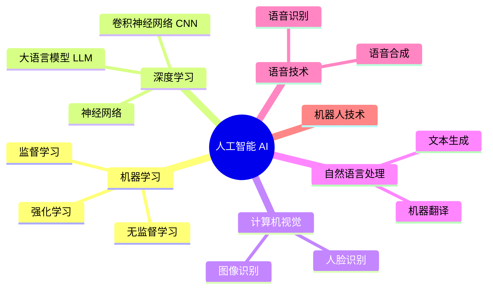
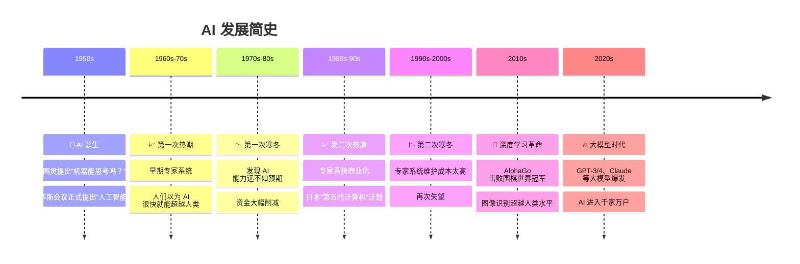
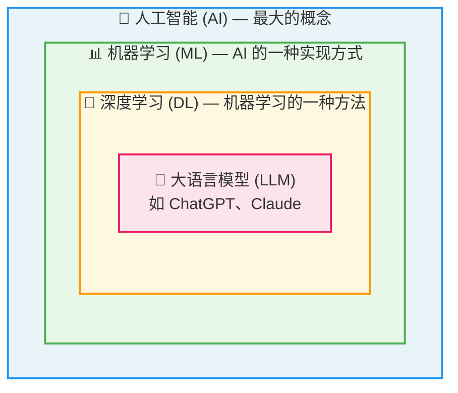
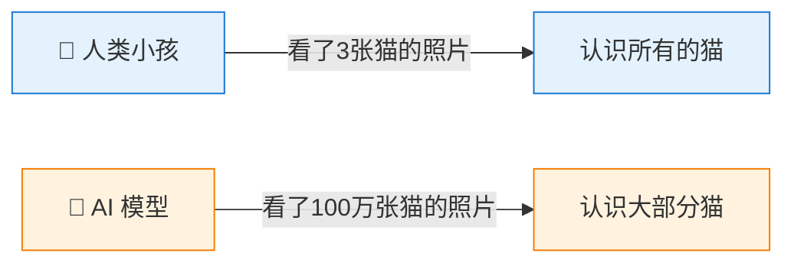
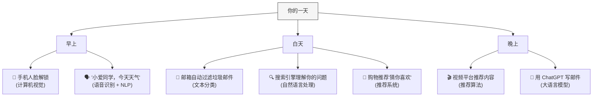
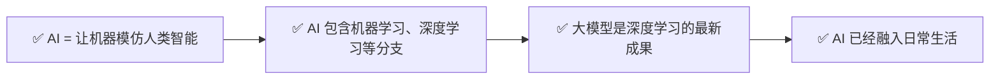

# 什么是人工智能？—— 从零开始理解 AI

> 🎯 读完这篇，你将知道：AI 到底是什么、它经历了怎样的发展、它和人类智能有什么区别。

---

## 一句话解释 AI

**人工智能（Artificial Intelligence，简称 AI）= 让机器模仿人类智能行为的技术。**

就像我们教小孩认字、算数、判断对错一样，AI 就是"教"计算机做类似的事情——识别图片、理解语言、做出决策。

---

## AI 不是一个"东西"，而是一个"领域"

很多人以为 AI 是某个具体的产品（比如 ChatGPT），但其实 AI 是一个巨大的技术领域，包含很多分支：

> 💡 ChatGPT、Claude 这些产品，属于 AI 领域中"大语言模型"这个分支。

---

## AI 的发展简史：三起三落

AI 并不是最近才出现的，它已经有 70 多年的历史了：

---

## AI、机器学习、深度学习、大模型——它们是什么关系？

这四个概念经常被混用，但它们其实是**层层包含**的关系：

用一个比喻来理解：

| 概念 | 比喻 | 说明 |
|------|------|------|
| **人工智能** | 交通工具 | 所有让机器变"聪明"的技术 |
| **机器学习** | 汽车 | 让机器从数据中自动学习的方法 |
| **深度学习** | 电动汽车 | 用"神经网络"这种特殊结构来学习 |
| **大语言模型** | 特斯拉 | 超大规模的深度学习模型，专门处理语言 |

---

## AI vs 人类智能：有什么不同？

| 对比维度 | 人类智能 🧑 | 人工智能 🤖 |
|----------|------------|------------|
| **学习方式** | 从少量经验中举一反三 | 需要海量数据反复训练 |
| **擅长领域** | 创造力、情感、常识推理 | 大规模计算、模式识别、不知疲倦 |
| **速度** | 思考需要时间 | 毫秒级响应 |
| **犯错方式** | 粗心、遗忘 | "一本正经地胡说八道"（幻觉） |
| **理解能力** | 真正理解含义 | 统计规律的模拟，不真正"理解" |
| **通用性** | 一个人能做很多不同的事 | 目前大多数 AI 只擅长特定任务 |

> 人类能从极少的例子中学习（这叫"小样本学习"），而 AI 通常需要大量数据。不过大模型正在缩小这个差距。

---

## 生活中的 AI，你可能每天都在用

你可能觉得 AI 离你很远，但其实它已经无处不在：

---

## 本篇小结

---

## 下一篇预告

我们知道了 AI 是什么，但它到底是怎么"学会"做事情的呢？下一篇 [AI 是怎么"学习"的？—— 机器学习入门](02-how-ai-learns.md)，我们用最通俗的方式聊聊机器学习。

---

[⬅️ 返回目录](README.md) | [下一篇 ➡️](02-how-ai-learns.md)
