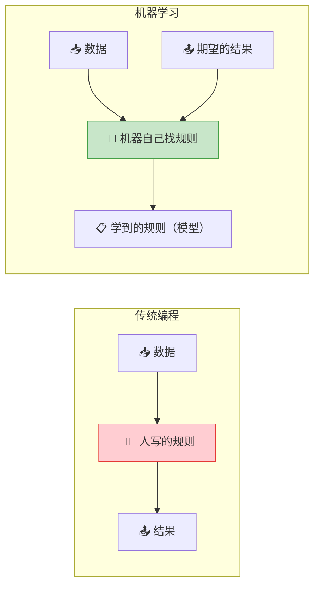
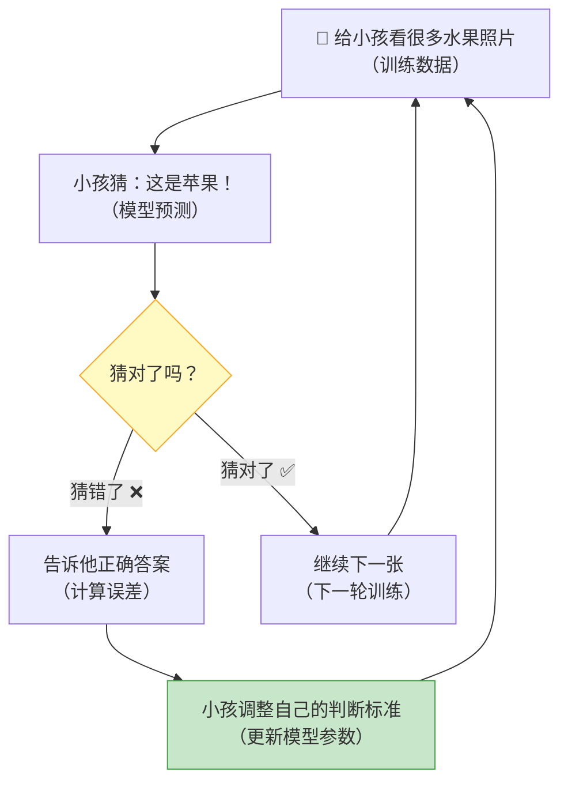
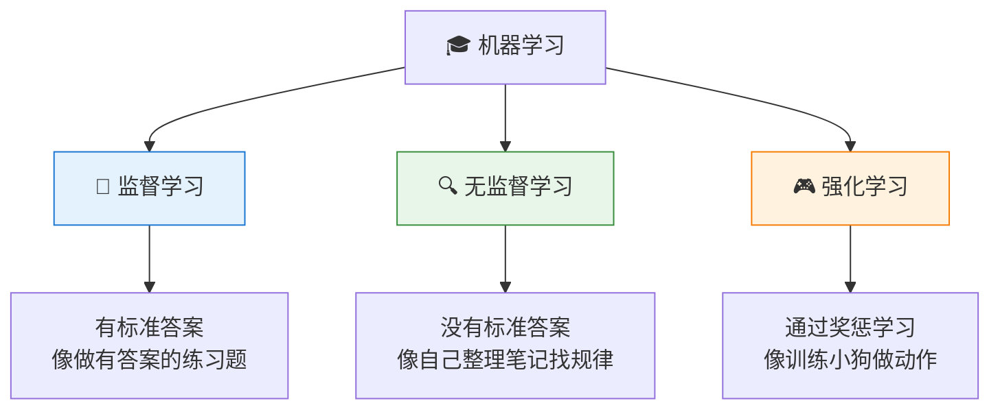
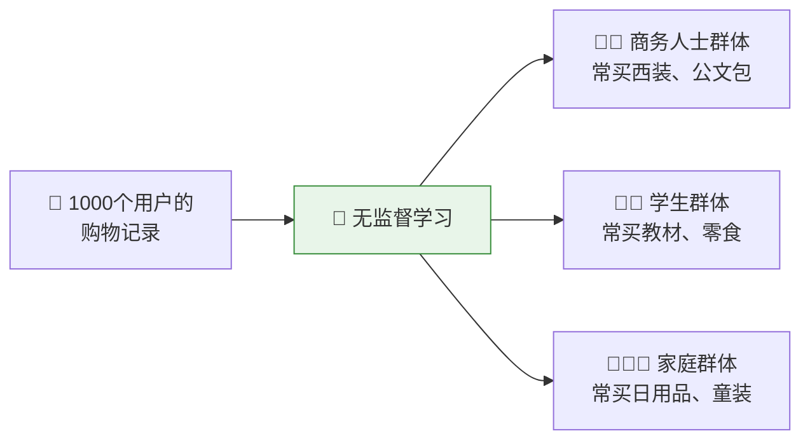
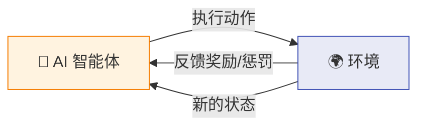
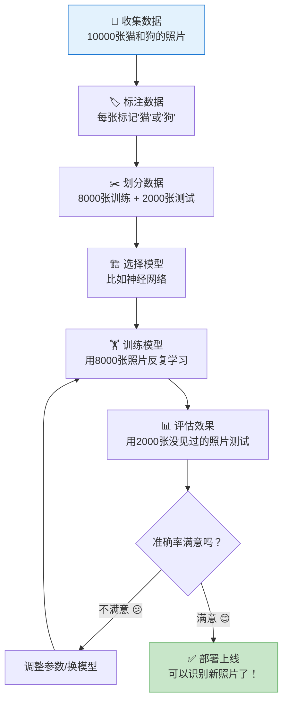
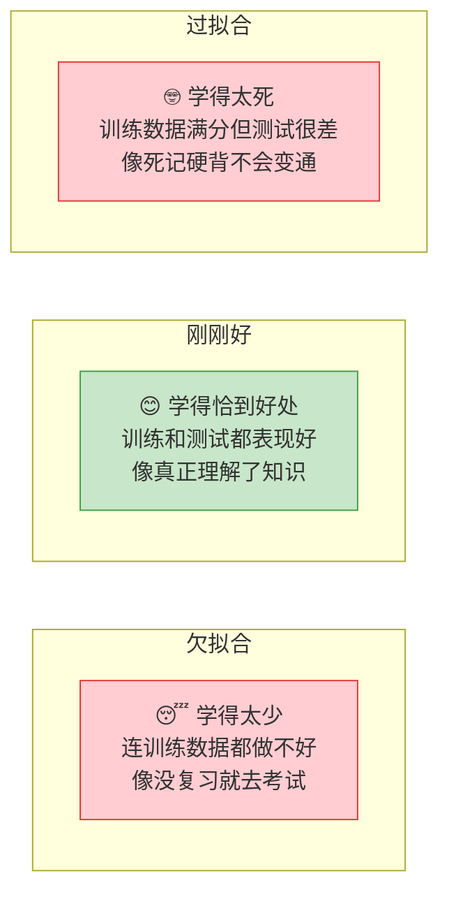
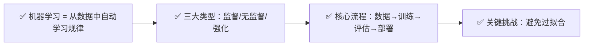

# AI 是怎么"学习"的？—— 机器学习入门

> 🎯 读完这篇，你将知道：机器学习的核心思想、三种主要类型、以及它和"传统编程"的本质区别。

---

## 传统编程 vs 机器学习：思路完全不同

先看一个关键区别——这是理解机器学习的钥匙：

**传统编程**：人告诉计算机"如果邮件包含'中奖'就标记为垃圾邮件"——规则是人写的。

**机器学习**：给计算机看 100 万封邮件（标记好哪些是垃圾邮件），让它自己总结出规律——规则是机器学的。

> 💡 核心区别：传统编程是"人教规则"，机器学习是"机器自己从数据中发现规则"。

---

## 机器学习是怎么"学"的？—— 一个直觉解释

想象你在教一个小孩认水果：

机器学习的过程和这个完全一样：

1. **喂数据**：给模型大量带标签的数据
2. **做预测**：模型根据当前的"经验"做出猜测
3. **算误差**：对比猜测和正确答案，计算差距
4. **调整参数**：根据误差调整内部参数，让下次猜得更准
5. **重复**：循环成千上万次，模型越来越准

---

## 机器学习的三大类型

### 1️⃣ 监督学习：有老师指导

给模型"题目"和"标准答案"，让它学会从题目推导出答案。

| 应用场景 | "题目"（输入） | "答案"（输出） |
|----------|---------------|---------------|
| 垃圾邮件过滤 | 一封邮件的内容 | 是/不是垃圾邮件 |
| 房价预测 | 面积、位置、楼层 | 预测价格 |
| 图片识别 | 一张照片 | 猫/狗/鸟 |
| 医疗诊断 | X光片 | 正常/异常 |

### 2️⃣ 无监督学习：自己找规律

没有标准答案，让模型自己在数据中发现隐藏的结构和规律。

> 你没有告诉它"这个用户是学生"，它自己从购物行为中发现了这些群体。

### 3️⃣ 强化学习：试错中成长

通过"奖励"和"惩罚"来学习，就像训练宠物：做对了给零食，做错了不给。

**经典案例**：
- AlphaGo 下围棋：赢了得奖励，输了受惩罚，自己和自己下了几百万盘棋
- 自动驾驶：安全行驶得奖励，违规得惩罚
- 游戏 AI：通关得分高得奖励

---

## 一个完整的例子：教 AI 识别猫和狗

让我们走一遍完整的机器学习流程：

**为什么要分"训练集"和"测试集"？**

就像考试一样——如果用练习题来考试，满分不代表真的学会了。必须用没见过的题目来检验真实水平。

---

## 机器学习中的关键概念

### 欠拟合 vs 过拟合

**过拟合**是机器学习中最常见的问题：模型把训练数据的噪音和细节都"背"下来了，遇到新数据就不行了。

> 💡 好的模型要学会"举一反三"，而不是"死记硬背"。

---

## 本篇小结

---

## 下一篇预告

机器学习有很多方法，其中最强大的一种叫"神经网络"——它模仿了人脑的工作方式。下一篇 [神经网络：模仿人脑的计算机程序](03-neural-networks.md)，我们来看看它是怎么回事。

---

[⬅️ 上一篇](01-what-is-ai.md) | [返回目录](README.md) | [下一篇 ➡️](03-neural-networks.md)
