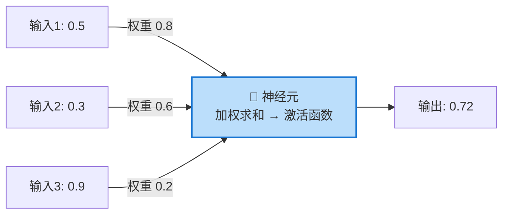
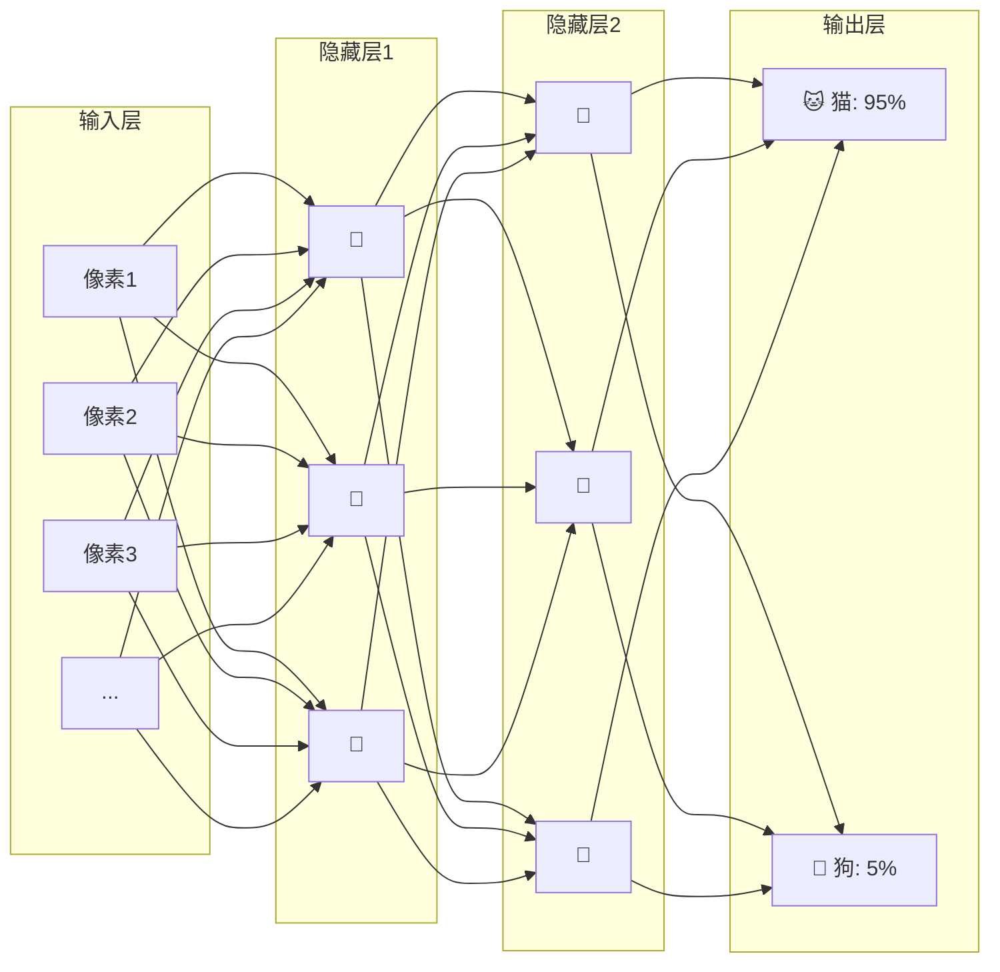
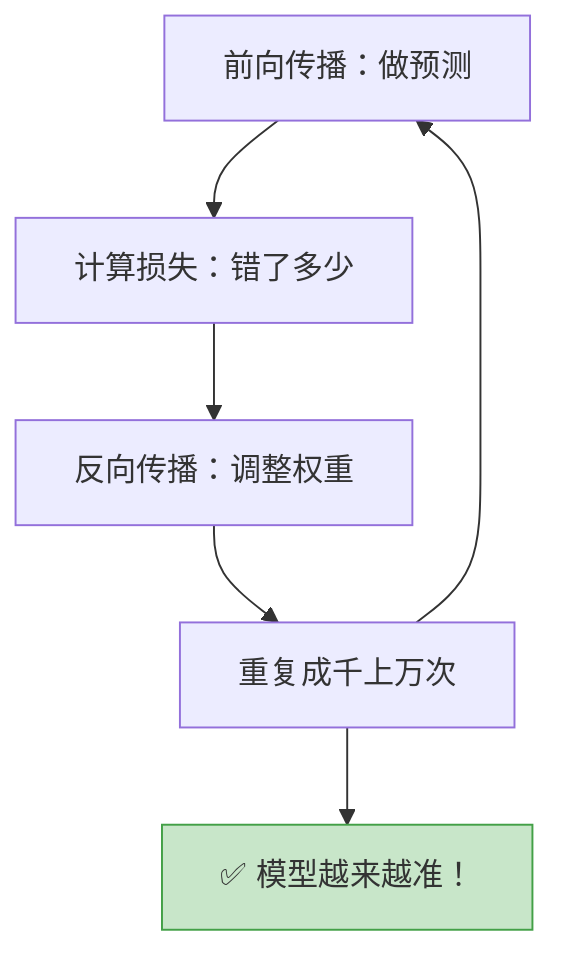
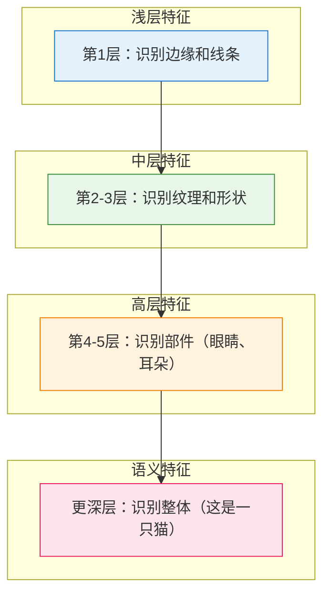
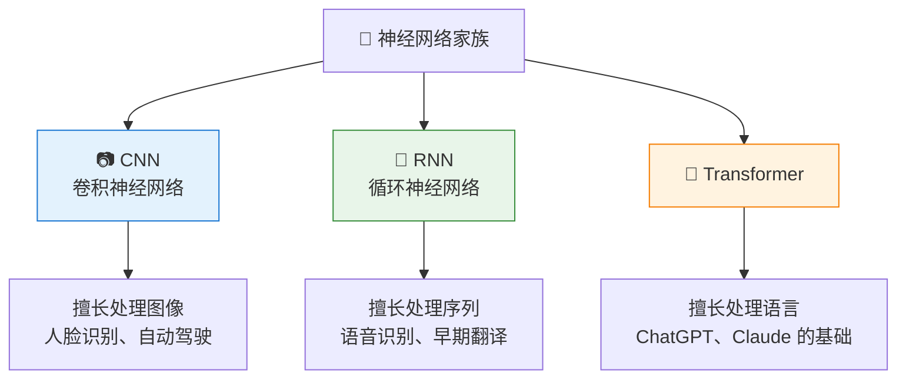
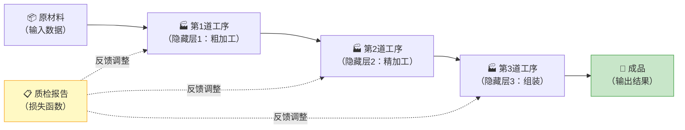

# 神经网络：模仿人脑的计算机程序

> 🎯 读完这篇，你将知道：神经网络是什么、它为什么叫"神经"网络、它是怎么一层一层处理信息的。

---

## 从人脑说起

人脑有大约 860 亿个神经元，它们通过"突触"相互连接。当你看到一只猫时：

科学家想：**能不能用数学模拟这个过程？** 于是就有了人工神经网络。

---

## 一个人工神经元长什么样？

一个人工神经元做的事情非常简单：

它只做三步：
1. **接收输入**：从上一层拿到数据
2. **加权求和**：每个输入乘以一个"权重"（重要程度），然后加起来
3. **激活函数**：通过一个函数决定是否"激活"（输出信号）

> 💡 **权重**就是神经网络要"学习"的东西。训练的过程就是不断调整这些权重，让输出越来越准确。

---

## 把神经元连起来：神经网络

单个神经元能力有限，但把很多神经元**分层连接**起来，就能处理复杂问题：

**三种层的作用：**

| 层 | 作用 | 比喻 |
|----|------|------|
| **输入层** | 接收原始数据（图片像素、文字等） | 你的眼睛和耳朵 |
| **隐藏层** | 提取特征、发现规律（可以有很多层） | 大脑的思考过程 |
| **输出层** | 给出最终结果 | 你说出的答案 |

---

## 神经网络是怎么"学习"的？

### 第一步：前向传播——做出预测

数据从输入层流向输出层，每一层都在处理和转换信息：

### 第二步：计算损失——错了多少？

用一个"损失函数"来衡量预测结果和正确答案之间的差距：

> 正确答案是"猫"，模型说"30%是猫"→ 损失很大 ❌
> 正确答案是"猫"，模型说"95%是猫"→ 损失很小 ✅

### 第三步：反向传播——调整权重

这是神经网络学习的核心！从输出层往回走，计算每个权重对误差的"贡献"，然后调整它们：

> 💡 **反向传播**就像老师批改试卷后，学生回去检查每一步哪里出了错，然后改正。

### 第四步：重复！

一次完整的"前向传播→计算损失→反向传播"叫做一个**训练步骤**。通常需要重复几万到几百万次，模型才能学好。

---

## 为什么"深度"很重要？

"深度学习"中的"深度"指的是**隐藏层的数量**。层数越多，模型能学到的特征就越复杂：

> 就像人类认知：先看到线条 → 再看到形状 → 再认出部件 → 最后认出整体。

**层数对比：**

| 模型类型 | 层数 | 能力 |
|----------|------|------|
| 简单神经网络 | 2-3 层 | 简单分类 |
| 深度神经网络 | 10-50 层 | 图像识别、语音识别 |
| 大语言模型 | 32-96 层 | 理解和生成语言 |

---

## 不同类型的神经网络

| 类型 | 擅长 | 代表应用 |
|------|------|----------|
| **CNN（卷积神经网络）** | 图像处理 | 人脸识别、医学影像 |
| **RNN（循环神经网络）** | 序列数据 | 早期的语音识别、翻译 |
| **Transformer** | 语言理解与生成 | GPT、BERT、Claude |

> 💡 Transformer 是 2017 年提出的架构，它彻底改变了 AI 领域，是当今所有大模型的基础。下一篇我们会详细讲它。

---

## 一个生活化的总结

把神经网络想象成一个**工厂流水线**：

- 原材料 = 输入数据
- 每道工序 = 一个隐藏层，负责提取不同层次的特征
- 成品 = 模型的预测结果
- 质检报告 = 损失函数，告诉工厂哪里需要改进

---

## 本篇小结

---

## 下一篇预告

我们知道了神经网络的基本原理，那"大模型"到底"大"在哪里？为什么参数越多越厉害？下一篇 [大模型到底"大"在哪里？—— 从 GPT 说起](04-what-makes-llm-large.md)，我们来揭开大模型的面纱。

---

[⬅️ 上一篇](02-how-ai-learns.md) | [返回目录](README.md) | [下一篇 ➡️](04-what-makes-llm-large.md)
