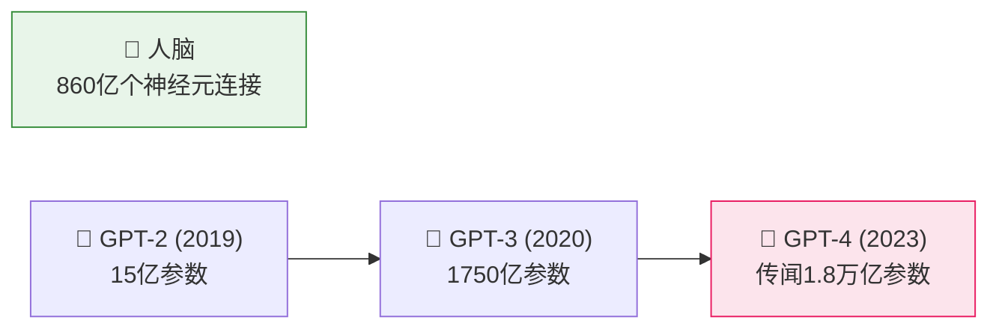
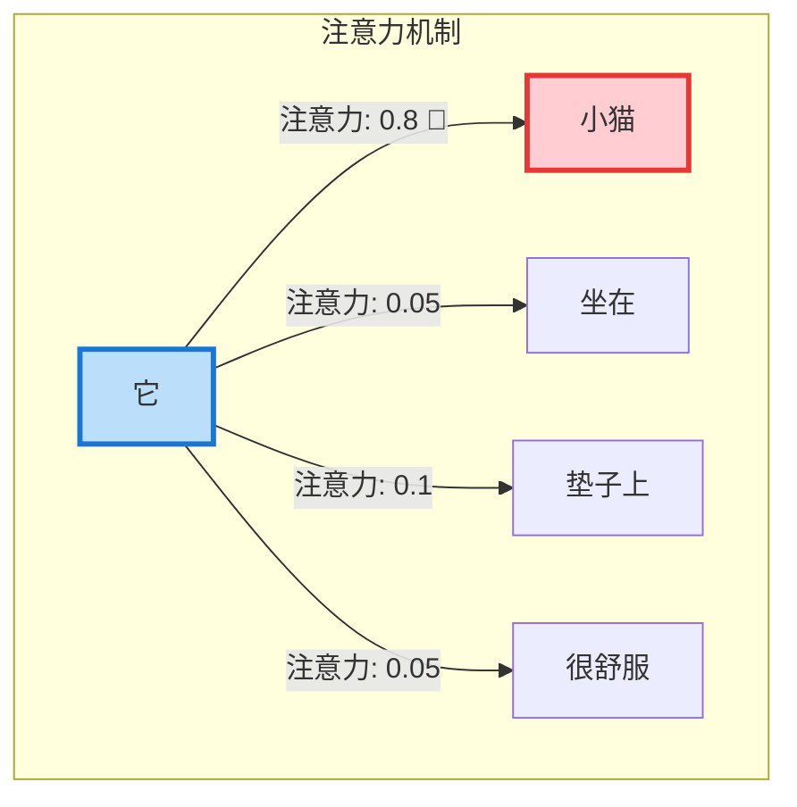
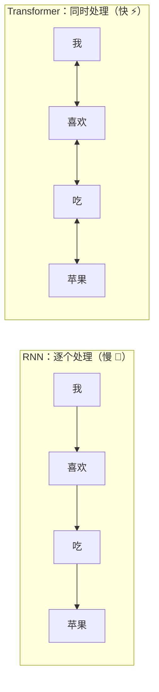
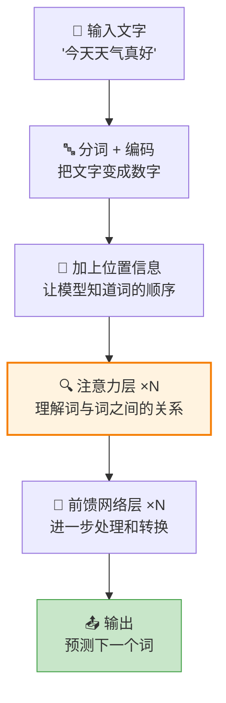
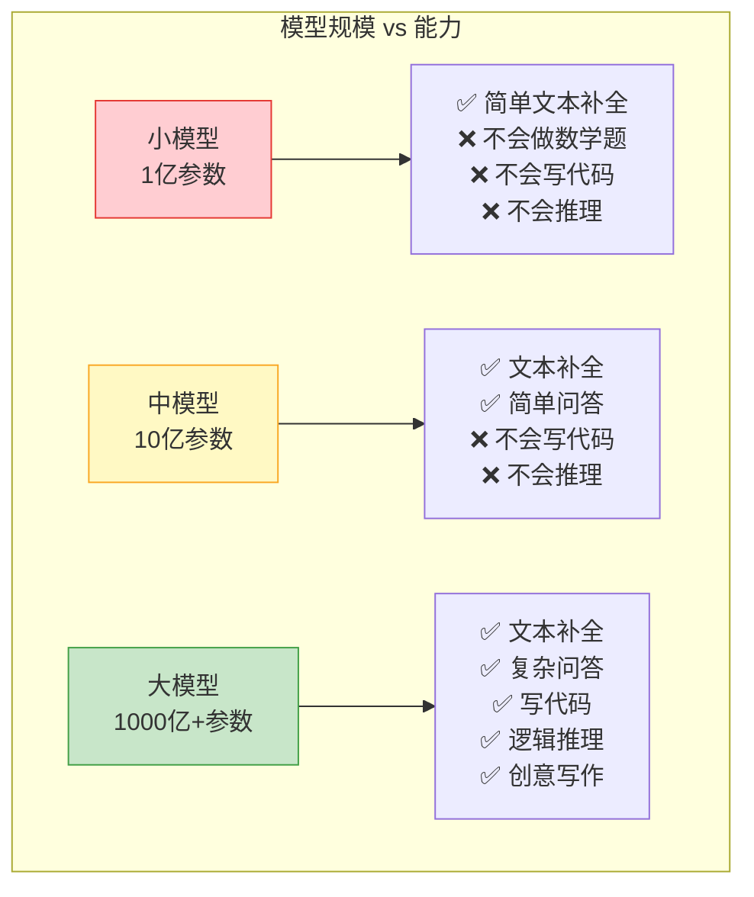
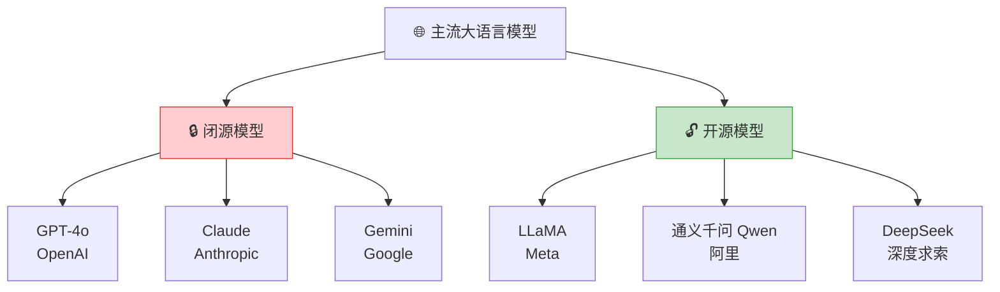
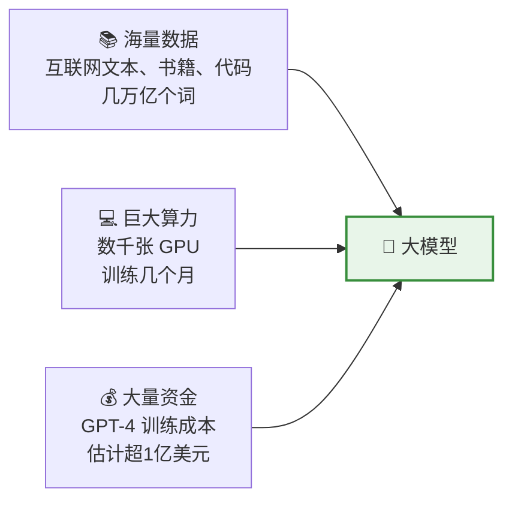
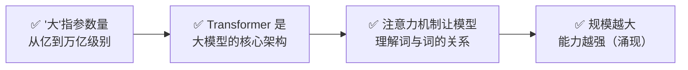

# 大模型到底"大"在哪里？—— 从 GPT 说起

> 🎯 读完这篇，你将知道：大模型为什么叫"大"、Transformer 架构的核心思想、以及为什么参数越多模型越强。

---

## "大"模型到底有多大？

我们常说的"大模型"，到底大在哪里？答案是：**参数数量**。

**参数是什么？** 还记得上一篇说的"权重"吗？参数就是神经网络中所有权重的总数。参数越多，模型能记住和理解的"知识"就越多。

用一个比喻来理解：

| 模型 | 参数量 | 比喻 |
|------|--------|------|
| 小模型（百万级） | ~1亿 | 📖 一本书的知识量 |
| 中模型（十亿级） | ~10亿 | 📚 一个书架的知识量 |
| 大模型（千亿级） | ~1000亿 | 🏛️ 一座图书馆的知识量 |
| 超大模型（万亿级） | ~1万亿 | 🌍 多座图书馆的知识量 |

---

## 大模型的"大脑"：Transformer 架构

几乎所有现代大模型（GPT、Claude、LLaMA、Qwen……）都基于同一个架构：**Transformer**。

它是 2017 年 Google 在一篇名为《Attention Is All You Need》（注意力就是你所需要的一切）的论文中提出的。

### 核心思想：注意力机制

想象你在读这句话：

> "小猫坐在垫子上，**它**很舒服。"

你立刻知道"它"指的是"小猫"，而不是"垫子"。你是怎么做到的？因为你的大脑会**关注**句子中最相关的部分。

Transformer 的"注意力机制"做的就是同样的事：

> 💡 **注意力机制**让模型在处理每个词时，能"看到"整个句子，并自动判断哪些词最重要。这就是 Transformer 的超能力。

### 为什么注意力机制这么厉害？

在 Transformer 之前，模型（如 RNN）只能**从左到右**逐个处理文字，就像用吸管喝水——一次只能喝一口：

Transformer 能**同时看到所有词**，就像一眼扫完整个句子。这带来两个巨大优势：
1. **理解更准确**：能捕捉远距离的关系（比如文章开头和结尾的呼应）
2. **训练更快**：可以并行计算，充分利用 GPU 的算力

---

## Transformer 的内部结构

不用记住每个细节，只需要理解大致流程：

**关键组件解释：**

| 组件 | 作用 | 通俗比喻 |
|------|------|----------|
| **分词器** | 把文字拆成小块（token） | 把句子拆成一个个积木块 |
| **位置编码** | 告诉模型每个词在第几个位置 | 给每个积木块编号 |
| **注意力层** | 让每个词"看到"其他所有词 | 每个积木块都能和其他积木块"交流" |
| **前馈网络** | 对信息做进一步加工 | 把交流后的信息整理归纳 |

> 一个 Transformer 模型通常有几十层注意力层叠加在一起。GPT-3 有 96 层，每一层都在更深入地理解文本。

---

## 为什么"大"就是好？—— 涌现能力

一个神奇的现象：当模型参数量超过某个临界点时，会突然"解锁"新能力，这叫**涌现能力（Emergent Abilities）**。

> 💡 就像水加热到 100°C 才会沸腾——模型参数量达到一定规模后，才会突然"开窍"，展现出之前完全没有的能力。

---

## 主流大模型一览

| 模型 | 公司 | 特点 |
|------|------|------|
| **GPT-4o** | OpenAI | 综合能力最强之一，支持图文 |
| **Claude** | Anthropic | 长文本处理强，注重安全 |
| **Gemini** | Google | 多模态，与 Google 生态集成 |
| **LLaMA** | Meta | 开源标杆，社区生态丰富 |
| **通义千问** | 阿里 | 中文能力强，开源 |
| **DeepSeek** | 深度求索 | 性价比高，推理能力强 |

---

## 训练一个大模型需要什么？

这就是为什么只有大公司才能从零训练大模型——普通人和小公司更多是**使用**大模型，或者在已有模型基础上做**微调**。

---

## 本篇小结

---

## 下一篇预告

我们知道了大模型的架构和规模，但它到底是怎么"读懂"你说的话，又怎么"写出"回答的呢？下一篇 [大模型是怎么理解和生成文字的？](05-how-llm-works.md)，我们来看看这个神奇的过程。

---

[⬅️ 上一篇](03-neural-networks.md) | [返回目录](README.md) | [下一篇 ➡️](05-how-llm-works.md)
