# 大模型是怎么理解和生成文字的？

> 🎯 读完这篇，你将知道：大模型如何把文字变成数字、如何预测下一个词、以及它的三阶段训练过程。

---

## 第一步：把文字变成数字——分词（Tokenization）

计算机不认识文字，只认识数字。所以第一步是把文字拆成小块（叫 **Token**），再转换成数字。

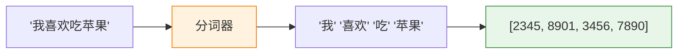

**Token 不一定是一个完整的字或词：**

| 原文 | Token 拆分 | 说明 |
|------|-----------|------|
| 我喜欢AI | 我 / 喜欢 / AI | 常见词保持完整 |
| Transformer | Trans / former | 长单词会被拆开 |
| 🎉 | 🎉 | emoji 也是一个 token |
| 人工智能 | 人工 / 智能 | 中文按词或字拆分 |

> 💡 GPT-4 的词表大约有 10 万个 token。你和 ChatGPT 对话时，它看到的不是文字，而是一串数字。

---

## 第二步：理解含义——词嵌入（Embedding）

光有数字编号还不够。"猫"和"狗"的编号可能差很远（比如 1024 和 50000），但它们的含义很接近。

**词嵌入**就是把每个 token 变成一个"含义向量"——一组能表达语义的数字：

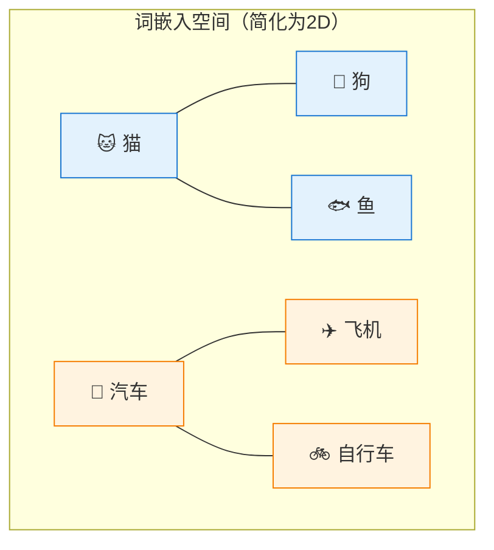

> 含义相近的词在向量空间中距离更近。"猫"和"狗"靠在一起，"猫"和"汽车"离得很远。

---

## 第三步：预测下一个词——大模型的核心能力

大模型的本质其实惊人地简单：**给定前面的文字，预测下一个最可能的词。**

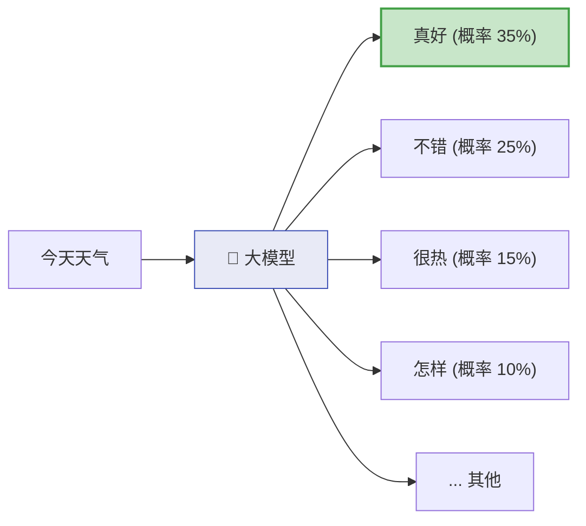

然后选一个词（比如"真好"），把它加到输入中，继续预测：

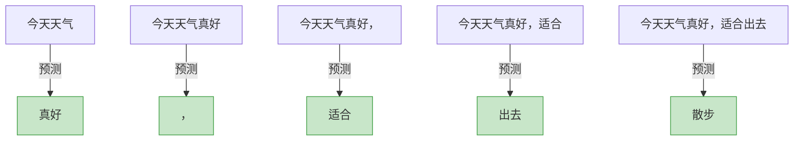

> 💡 ChatGPT 回复你的时候，就是在一个词一个词地"接龙"。它并不是一次性想好整个回答，而是每次只预测下一个词。

---

## 一个完整的对话过程

当你问 ChatGPT "什么是光合作用？"时，背后发生了什么：

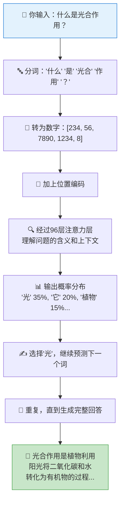

---

## 大模型的三阶段训练

一个大模型从"什么都不会"到"能和你聊天"，需要经过三个阶段：

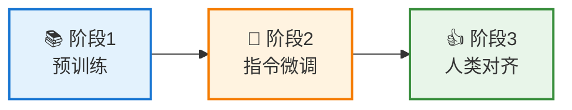

### 阶段 1：预训练——博览群书

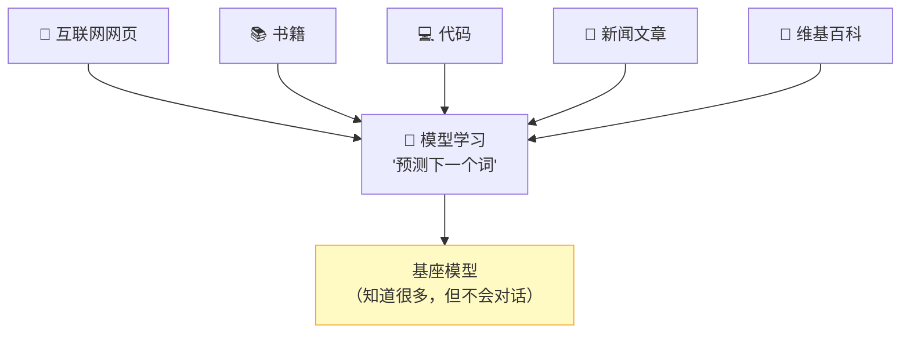

- **数据量**：几万亿个词（相当于几百万本书）
- **学习方式**：不断预测下一个词
- **结果**：模型学会了语言规律和世界知识，但还不会"聊天"

> 这时候的模型就像一个读了无数书的学者，但你问他问题，他可能会继续"写文章"而不是"回答你"。

### 阶段 2：指令微调——学会对话

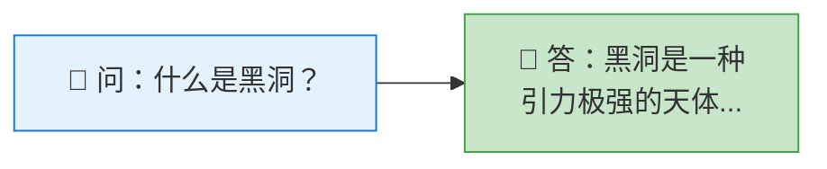

用大量"问题-回答"的数据来训练，让模型学会：
- 理解用户的意图
- 以对话的方式回答
- 遵循指令（"用 100 字总结"、"翻译成英文"等）

### 阶段 3：人类对齐——变得有用且安全

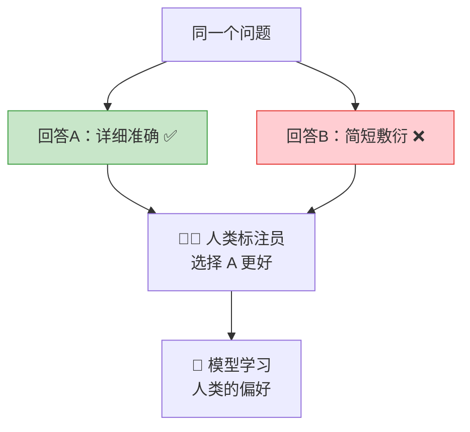

让人类评判模型的多个回答哪个更好，然后训练模型去生成人类更喜欢的回答。这个过程叫 **RLHF（基于人类反馈的强化学习）**。

目标是让模型：
- ✅ **有帮助**：真正解决用户的问题
- ✅ **诚实**：不确定时说"我不知道"
- ✅ **安全**：拒绝有害请求

---

## 温度（Temperature）：控制创造力

你可能注意到，同一个问题问两次，大模型的回答可能不一样。这是因为它在选择下一个词时有一定的**随机性**，由"温度"参数控制：

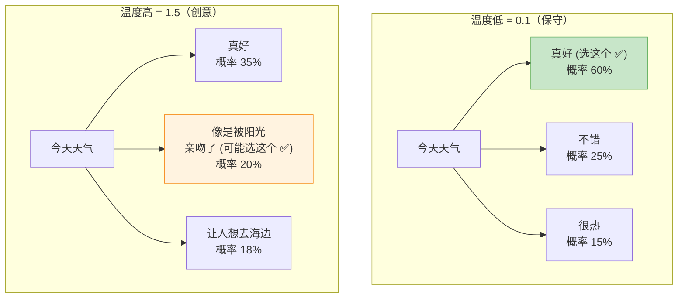

| 温度 | 效果 | 适合场景 |
|------|------|----------|
| 低（0-0.3） | 回答稳定、确定性高 | 事实问答、代码生成 |
| 中（0.5-0.8） | 平衡准确性和多样性 | 日常对话 |
| 高（0.8-1.5） | 回答多样、有创意 | 创意写作、头脑风暴 |

---

## 本篇小结

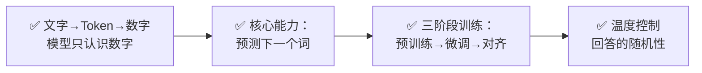

---

## 下一篇预告

现在你知道了大模型的工作原理，那它到底能做哪些事情呢？下一篇 [大模型能做什么？—— 能力全景图](06-what-llm-can-do.md)，我们来全面看看大模型的十八般武艺。

---

[⬅️ 上一篇](04-what-makes-llm-large.md) | [返回目录](README.md) | [下一篇 ➡️](06-what-llm-can-do.md)
