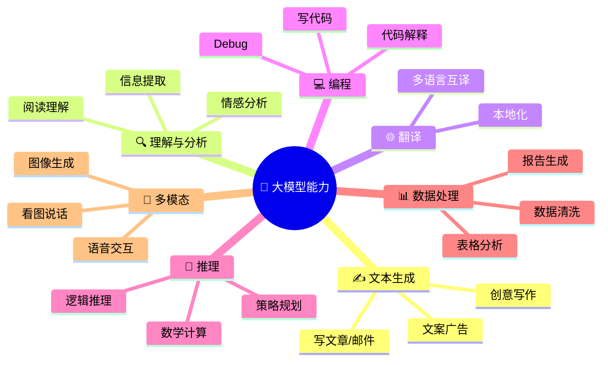
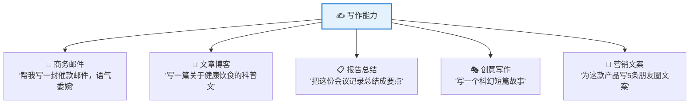
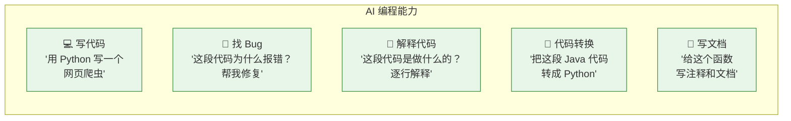
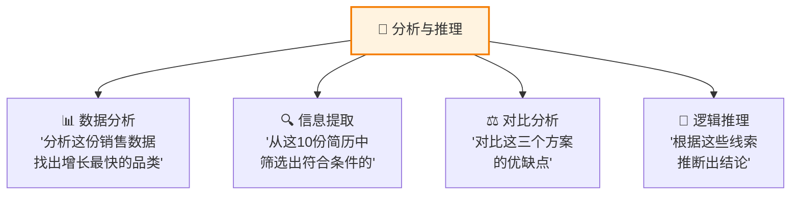
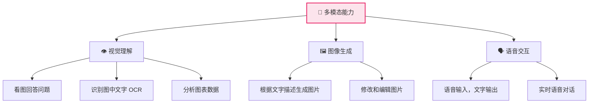
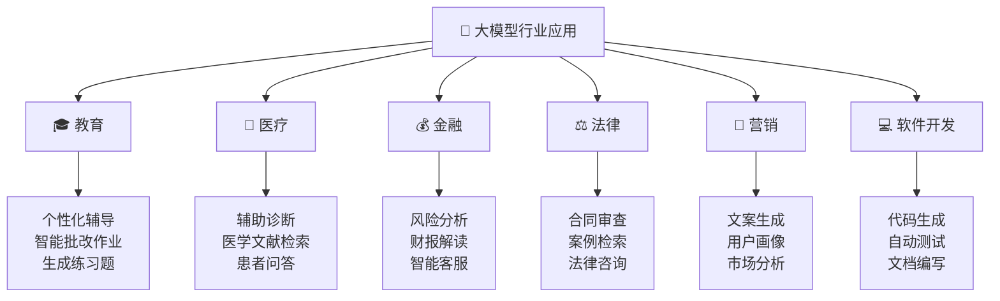
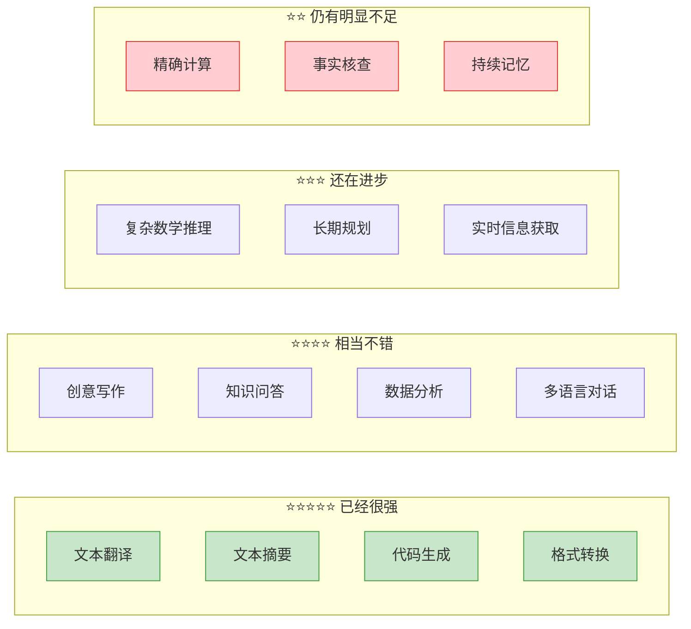
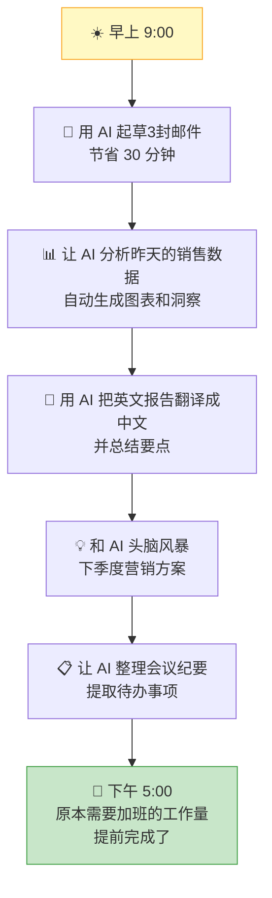
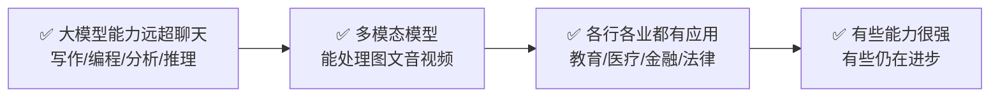

# 大模型能做什么？—— 能力全景图

> 🎯 读完这篇，你将知道：大模型在哪些领域已经很强、各行业的实际应用场景、以及多模态模型的新能力。

---

## 大模型的核心能力

大模型不只是"聊天机器人"，它的能力远比你想象的广泛：

---

## 能力一：写作与创作

大模型最直观的能力——帮你写各种文字内容：

**实际效果对比：**

| 任务 | 人类耗时 | AI 耗时 | AI 质量 |
|------|----------|---------|---------|
| 写一封商务邮件 | 15-30 分钟 | 10 秒 | ⭐⭐⭐⭐ 很好，需微调语气 |
| 写一篇 2000 字文章 | 2-4 小时 | 30 秒 | ⭐⭐⭐ 框架好，需补充细节 |
| 翻译一页文档 | 30-60 分钟 | 5 秒 | ⭐⭐⭐⭐ 接近专业水平 |
| 写一首诗 | 因人而异 | 5 秒 | ⭐⭐⭐ 工整但缺少灵魂 |

---

## 能力二：编程助手

大模型已经成为程序员的"副驾驶"：

> 💡 据统计，使用 AI 编程助手的开发者，编码效率平均提升 30-50%。

---

## 能力三：分析与推理

大模型不只是"鹦鹉学舌"，它还能做一定程度的分析和推理：

---

## 能力四：多模态——不只是文字

最新的大模型已经能处理图片、音频、视频等多种信息：

**多模态应用示例：**

| 输入 | 你可以说 | AI 做什么 |
|------|----------|----------|
| 📸 一张菜品照片 | "这道菜怎么做？" | 识别菜品，给出食谱 |
| 📊 一张数据图表 | "分析这个趋势" | 读取图表数据，给出分析 |
| 📄 一份 PDF 文档 | "总结这份报告的要点" | 提取关键信息，生成摘要 |
| 🖼️ 一张设计稿 | "把这个设计转成网页代码" | 生成 HTML/CSS 代码 |

---

## 各行业的实际应用

---

## 大模型能力评级：哪些已经很强，哪些还不行？

---

## 一个真实的工作场景

看看大模型如何帮助一个普通上班族提高效率：

---

## 本篇小结

---

## 下一篇预告

知道了大模型能做什么，关键问题来了：怎么才能让它做得更好？下一篇 [如何用好大模型？—— Prompt 技巧与实战](07-prompt-engineering.md)，教你写出高质量的提示词。

---

[⬅️ 上一篇](05-how-llm-works.md) | [返回目录](README.md) | [下一篇 ➡️](07-prompt-engineering.md)
