# 如何用好大模型？—— Prompt 技巧与实战

> 🎯 读完这篇，你将知道：什么是 Prompt、为什么同一个模型不同人用效果差很多、以及让 AI 输出质量翻倍的实用技巧。

---

## 什么是 Prompt？

**Prompt（提示词）** 就是你给 AI 的指令或问题。它是你和大模型之间的"沟通语言"。

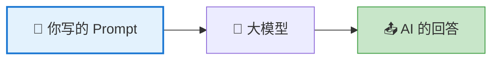

> 💡 同一个大模型，Prompt 写得好不好，输出质量可能天差地别。这就是为什么"Prompt Engineering（提示词工程）"成了一门热门技能。

---

## 差的 Prompt vs 好的 Prompt

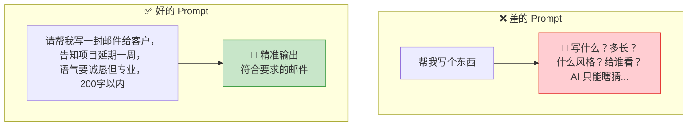

---

## 六大核心技巧

### 技巧 1：明确角色——告诉 AI "你是谁"

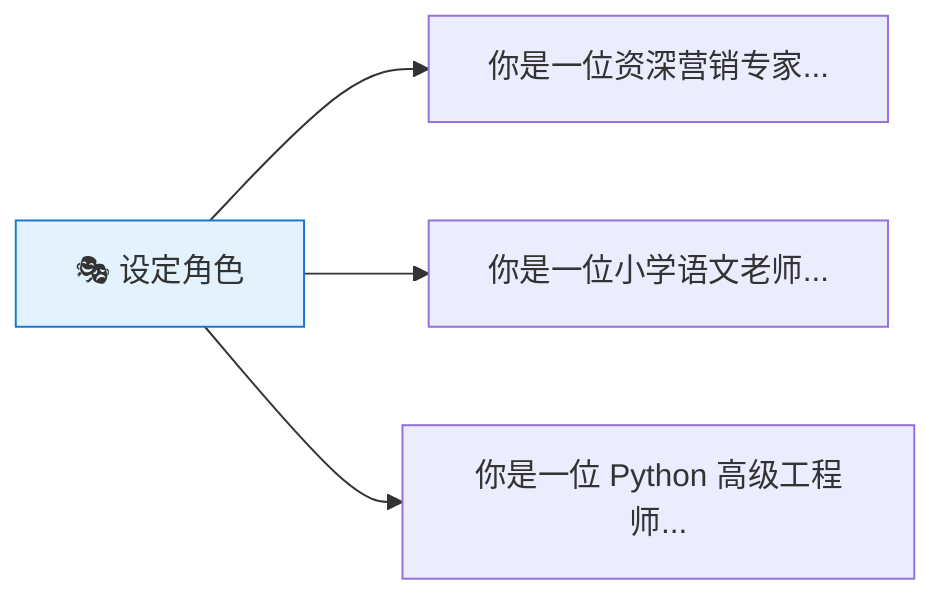

**对比：**

| 不设角色 | 设定角色 |
|----------|----------|
| "解释量子力学" | "你是一位科普作家，请用给10岁小孩讲故事的方式解释量子力学" |
| → 可能给出学术化的解释 | → 会用比喻和故事来讲解 |

### 技巧 2：提供上下文——给 AI 足够的背景信息

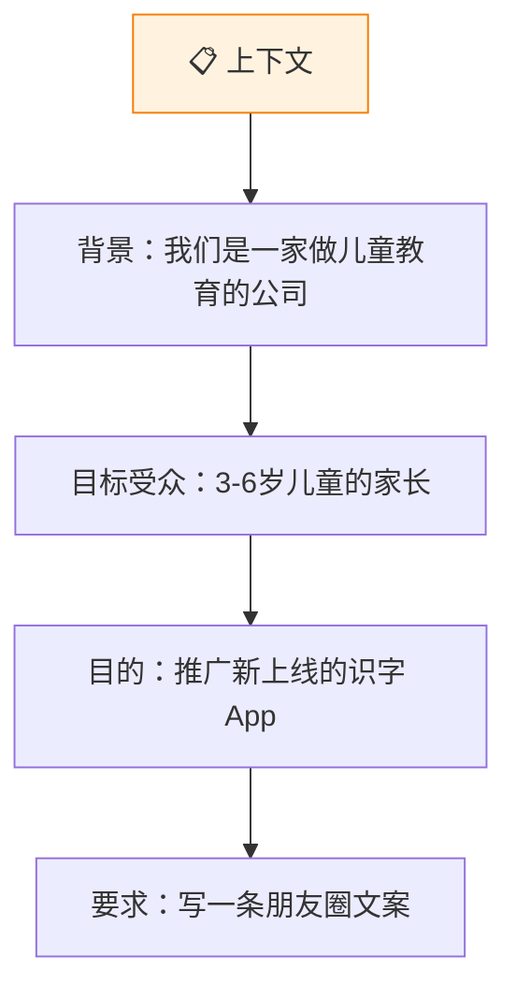

> 上下文越充分，AI 的输出越精准。不要让 AI 猜你要什么。

### 技巧 3：指定格式——告诉 AI 输出什么样子

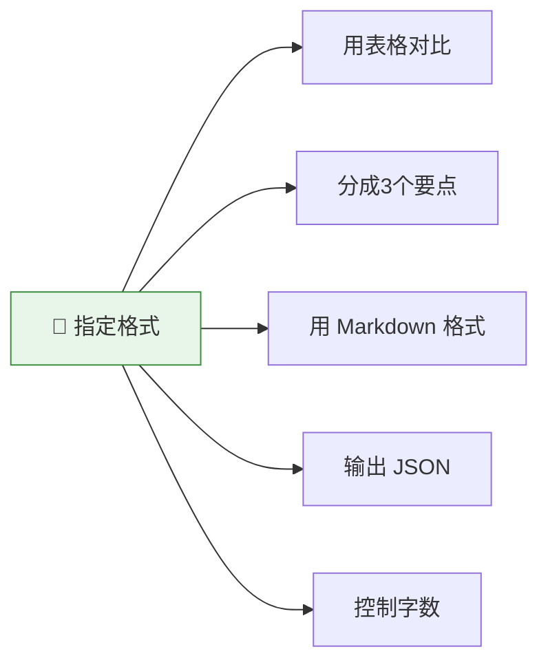

**示例：**
> "请对比 iPhone 和 Android 手机的优缺点，用表格形式呈现，每个方面用一句话概括。"

### 技巧 4：给出示例——Few-shot 提示

当你想要特定风格的输出时，给 AI 看几个例子最有效：

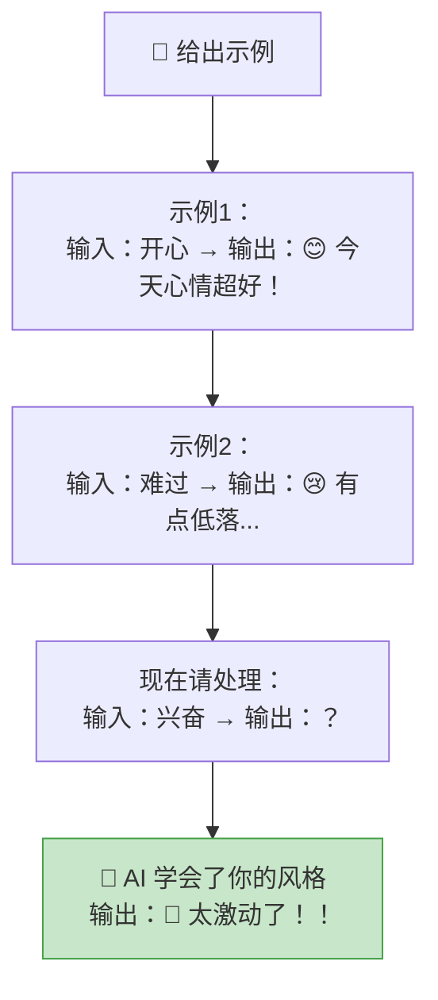

### 技巧 5：分步引导——让 AI "一步步思考"

复杂问题不要一次性问，引导 AI 分步骤思考：

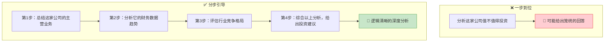

> 💡 这就是著名的 **Chain-of-Thought（思维链）** 技巧。加上"请一步步思考"这句话，AI 的推理准确率能大幅提升。

### 技巧 6：迭代优化——不满意就继续调

和 AI 对话不是"一锤子买卖"，你可以不断调整：

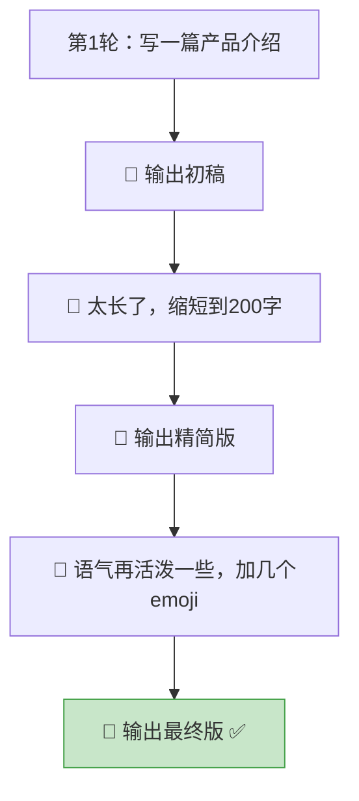

---

## Prompt 万能模板

把上面的技巧组合起来，就是一个万能模板：

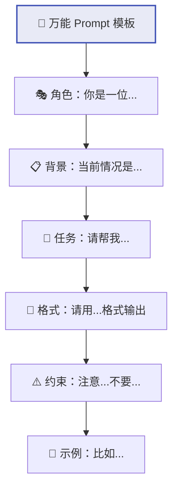

**实际应用举例：**

> **角色**：你是一位有10年经验的产品经理。
>
> **背景**：我们公司正在开发一款面向老年人的健康管理 App，目标用户是 60 岁以上、不太熟悉智能手机的老人。
>
> **任务**：请帮我设计 App 的核心功能列表。
>
> **格式**：用表格呈现，包含"功能名称"、"功能描述"、"优先级（高/中/低）"三列。
>
> **约束**：功能不超过 8 个，操作要尽可能简单，字体要大。

---

## 常见误区

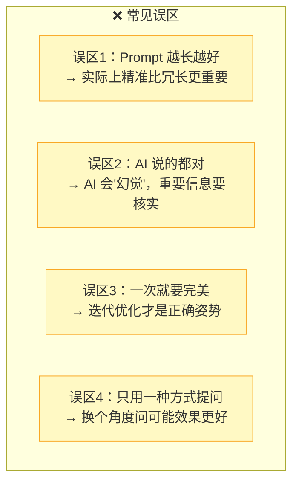

---

## 10 个即学即用的 Prompt 场景

| # | 场景 | Prompt 示例 |
|---|------|-------------|
| 1 | 邮件润色 | "帮我润色这封邮件，使其更专业、更简洁：[粘贴邮件]" |
| 2 | 会议纪要 | "根据以下会议记录，提取关键决策和待办事项，用列表呈现：[粘贴记录]" |
| 3 | 学习助手 | "用费曼技巧（假装教给一个小孩）解释[概念]" |
| 4 | 翻译+本地化 | "将以下内容翻译成英文，注意使用地道的美式英语表达：[粘贴内容]" |
| 5 | 头脑风暴 | "我想为[产品]做营销推广，请从5个不同角度给出创意方案" |
| 6 | 数据分析 | "分析以下数据，找出3个关键趋势和1个异常点：[粘贴数据]" |
| 7 | 面试准备 | "你是面试官，请针对[职位]出5道面试题，并给出参考答案" |
| 8 | 文档总结 | "用3个要点总结这篇文章的核心观点，每个要点不超过30字：[粘贴文章]" |
| 9 | 代码帮助 | "这段代码有什么问题？请找出 bug 并修复，解释原因：[粘贴代码]" |
| 10 | 决策辅助 | "我在纠结A和B两个选择，请从[维度1/维度2/维度3]三个角度帮我对比分析" |

---

## 进阶：让 AI 自我检查

一个高级技巧——让 AI 检查自己的回答：

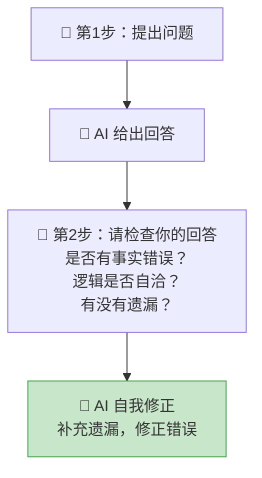

---

## 本篇小结

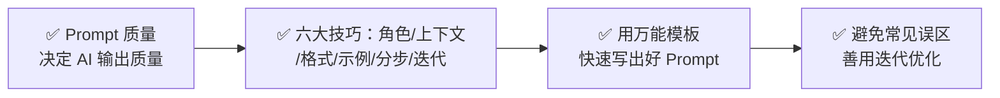

---

## 下一篇预告

大模型这么强大，它有没有做不到的事情？它的边界在哪里？下一篇 [AI 的未来与边界 —— 它不能做什么？](08-ai-limits-and-future.md)，我们来聊聊 AI 的局限性和未来。

---

[⬅️ 上一篇](06-what-llm-can-do.md) | [返回目录](README.md) | [下一篇 ➡️](08-ai-limits-and-future.md)
