# AI 的未来与边界 —— 它不能做什么？

> 🎯 读完这篇，你将知道：大模型的主要局限性、AI 带来的伦理问题、以及 AI 未来可能的发展方向。

---

## AI 不是万能的

前面几篇我们看到了大模型的强大能力，但了解它的**局限性**同样重要——这能帮你更好地使用它，也避免被误导。

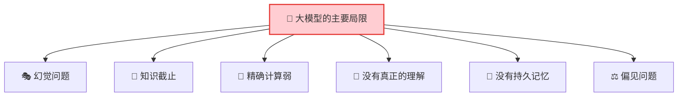

---

## 局限 1：幻觉——一本正经地胡说八道

这是大模型最著名的问题。它会非常自信地说出**完全错误**的信息：

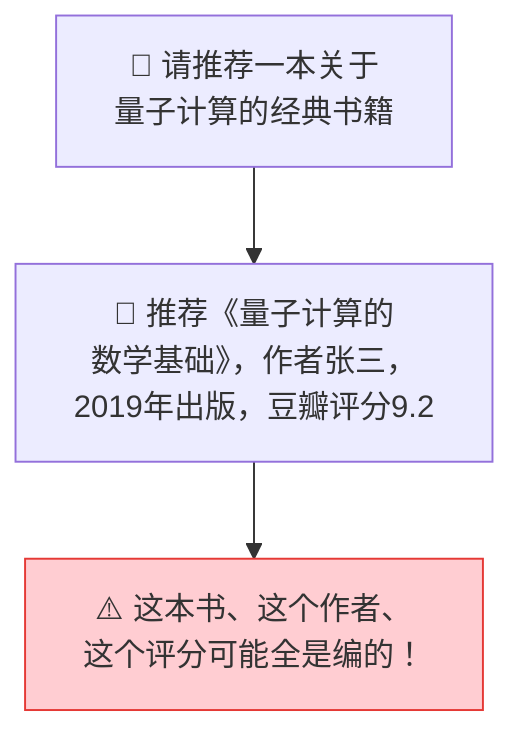

**为什么会产生幻觉？**

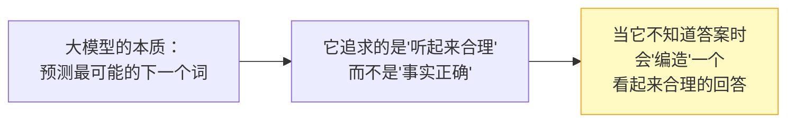

**应对策略：**
- ✅ 重要信息一定要交叉验证
- ✅ 让 AI 标注信息来源
- ✅ 对于事实性问题，多问一句"你确定吗？"
- ✅ 把 AI 当"助手"而不是"权威"

---

## 局限 2：知识有截止日期

大模型的知识来自训练数据，它不知道训练之后发生的事情：

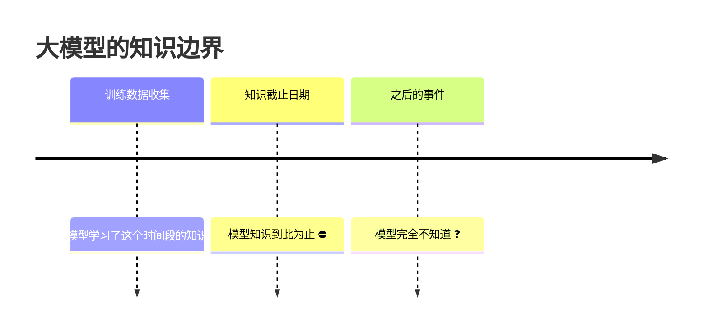

> 💡 这就是为什么有些 AI 产品会接入搜索引擎——让 AI 能获取最新信息。

---

## 局限 3：不擅长精确计算

大模型是"语言模型"，不是"计算器"：

| 任务 | AI 表现 | 说明 |
|------|---------|------|
| 23 × 47 = ? | ⚠️ 可能算错 | 它在"预测"答案，不是在"计算" |
| 统计一段话有多少个字 | ❌ 经常不准 | 它看到的是 token，不是字符 |
| 复杂数学证明 | ⚠️ 可能出错 | 多步推理容易累积错误 |

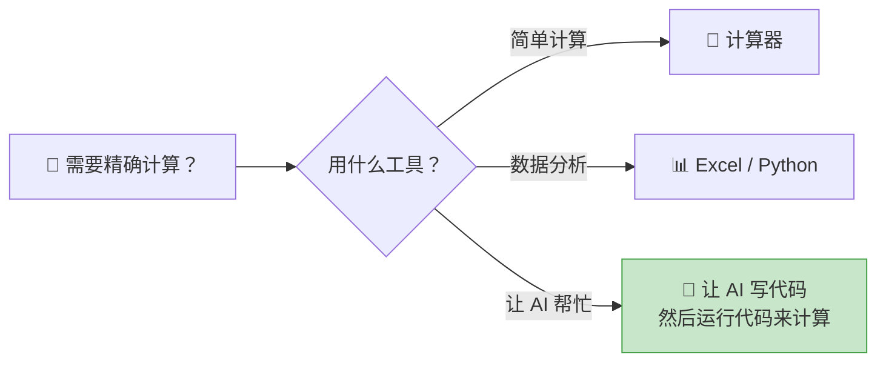

> 💡 正确的做法：不要让 AI 直接算，而是让 AI 写一段计算代码，然后运行代码得到精确结果。

---

## 局限 4：没有真正的"理解"

大模型看起来很"聪明"，但它并不真正理解含义：

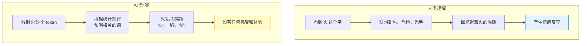

AI 是在做**极其高级的模式匹配**，而不是真正的思考。它没有意识、没有感受、没有真正的理解。

---

## 局限 5：没有持久记忆

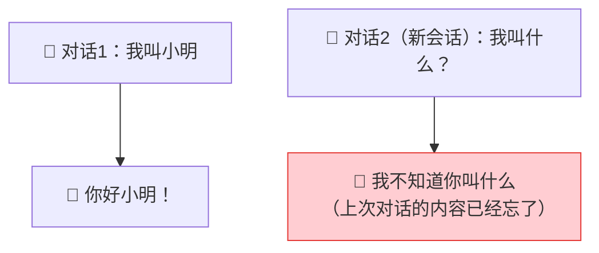

大模型没有跨会话的记忆。每次新对话，它都是"失忆"状态。虽然一些产品（如 ChatGPT）加入了记忆功能，但这是产品层面的补丁，不是模型本身的能力。

---

## AI 带来的伦理问题

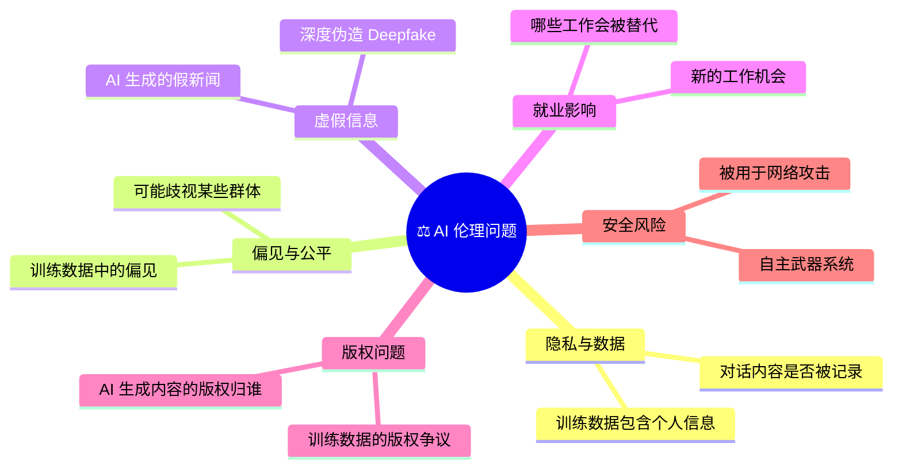

### AI 会取代人类的工作吗？

更准确的说法是：**AI 不会取代人，但会用 AI 的人会取代不用 AI 的人。**

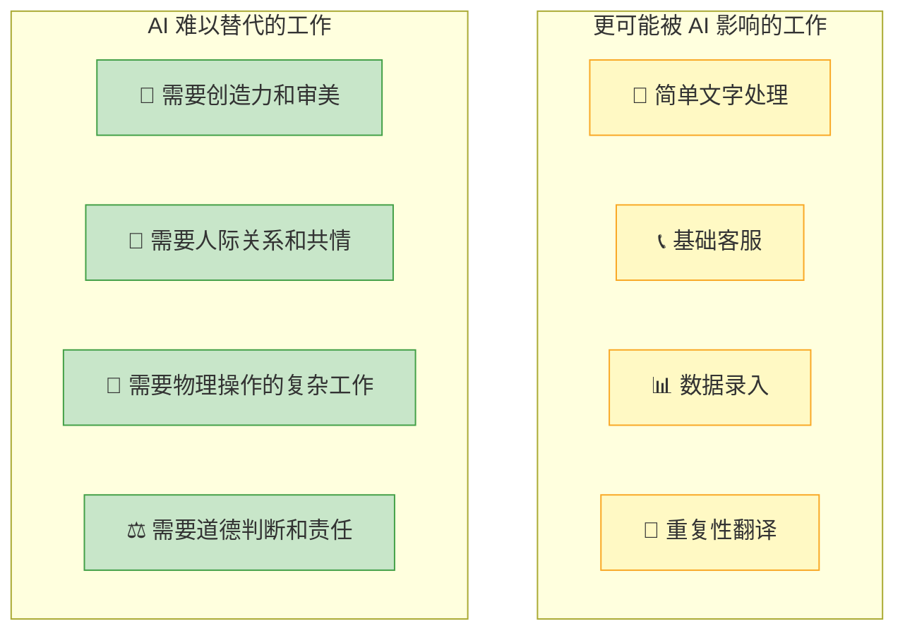

---

## AI 的未来：正在发生什么？

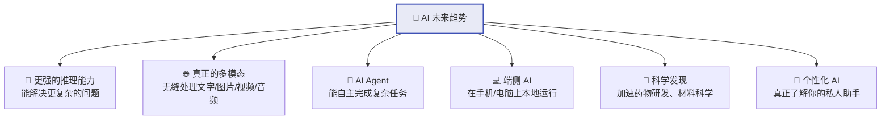

### AI Agent：从"回答问题"到"完成任务"

当前的 AI 主要是"你问我答"，未来的 AI Agent 能自主规划和执行复杂任务：

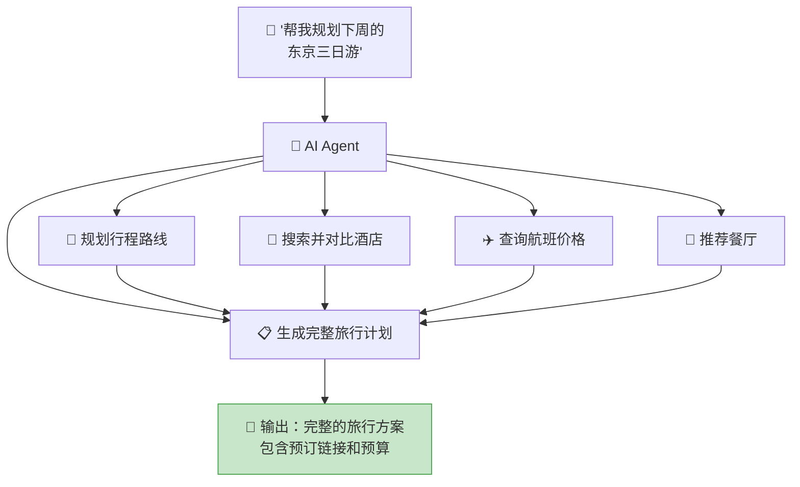

---

## 如何正确看待 AI？

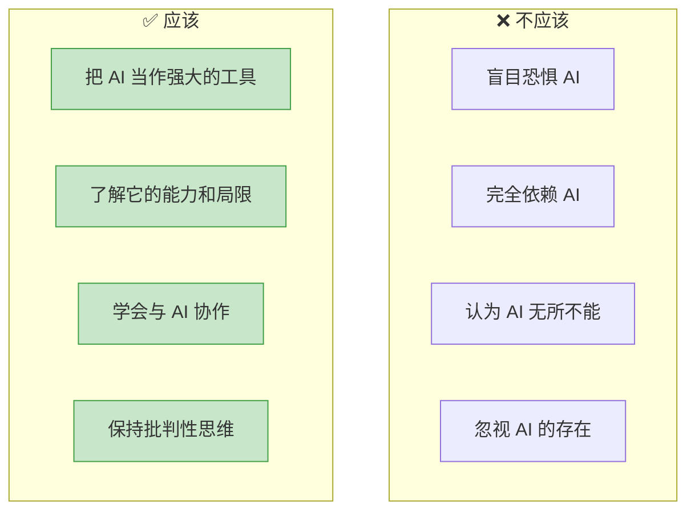

> 💡 AI 是人类有史以来创造的最强大的工具之一。和所有工具一样，关键在于**谁在使用它**以及**怎么使用它**。

---

## 给 AI 小白的行动建议

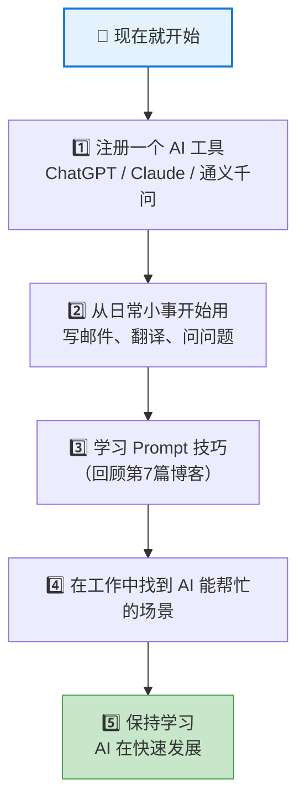

---

## 全系列总结

恭喜你读完了全部 8 篇博客！让我们回顾一下你学到了什么：

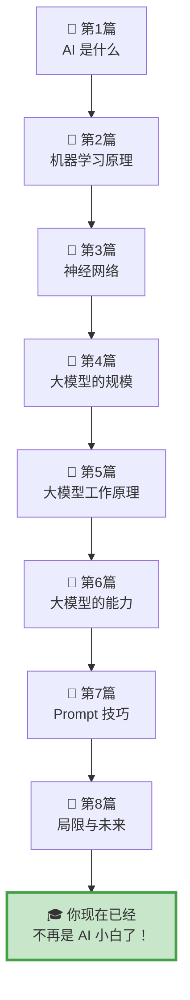

你现在已经了解了：
- ✅ AI 是什么，它的发展历史
- ✅ 机器学习和神经网络的基本原理
- ✅ 大模型为什么"大"，Transformer 是什么
- ✅ 大模型如何理解和生成文字
- ✅ 大模型能做什么，不能做什么
- ✅ 如何写好 Prompt 来高效使用 AI
- ✅ AI 的局限性、伦理问题和未来趋势

**下一步，就是动手用起来！** 🚀

---

[⬅️ 上一篇](07-prompt-engineering.md) | [返回目录](README.md)
