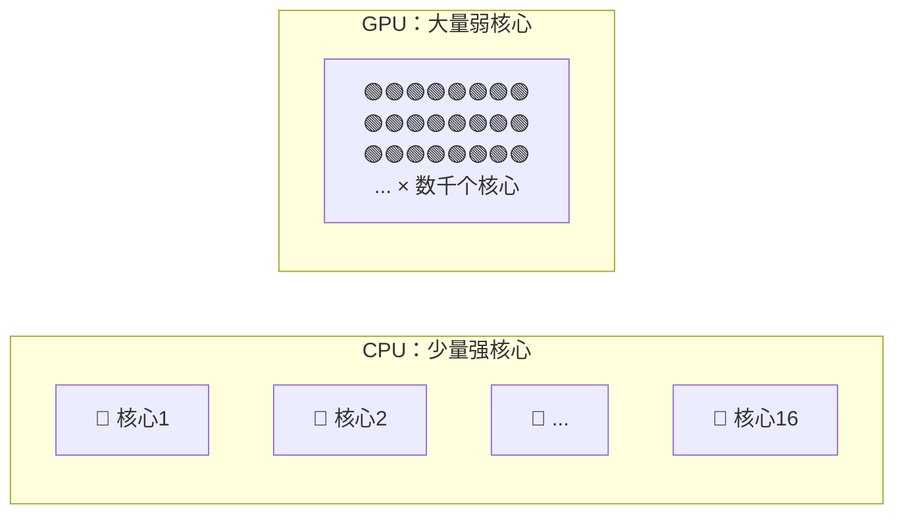
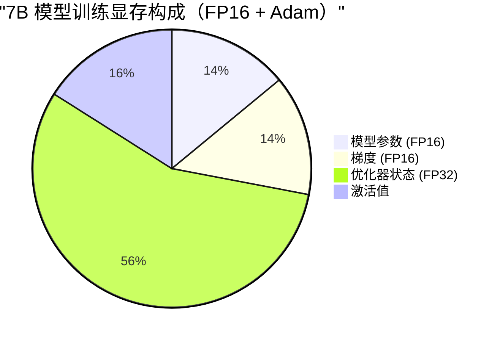
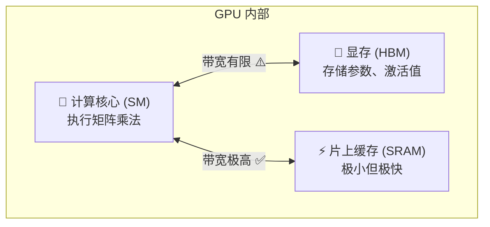

# GPU 与显存基础——理解性能优化的硬件基础

> 所有性能优化的起点：理解 GPU 的工作方式、显存的构成、以及瓶颈在哪里。

---

## GPU vs CPU：为什么训练用 GPU？



| 对比 | CPU | GPU |
|------|-----|-----|
| 核心数 | 8-64 个 | 数千~上万个 |
| 单核能力 | 强（复杂逻辑） | 弱（简单计算） |
| 擅长 | 串行任务、分支逻辑 | 大规模并行计算 |
| 类比 | 一个数学教授 | 一万个小学生 |

深度学习的核心运算是**矩阵乘法**——大量简单的乘加操作，天然适合 GPU 并行。

---

## GPU 显存构成：训练时显存都去哪了？

训练一个 7B 模型，FP16 权重只占 14GB，但实际需要 60-100GB 显存。为什么？



```python
def estimate_training_memory(params_b, seq_len=2048, batch_size=4, precision="fp16"):
    """估算训练显存需求"""
    bytes_per_param = 2 if precision == "fp16" else 4
    
    # 模型参数
    model_mem = params_b * 1e9 * bytes_per_param
    # 梯度（与参数同精度）
    grad_mem = params_b * 1e9 * bytes_per_param
    # Adam 优化器状态：2个 FP32 状态（momentum + variance）
    optimizer_mem = params_b * 1e9 * 4 * 2
    # 激活值（粗略估算）
    activation_mem = batch_size * seq_len * 4096 * 32 * bytes_per_param  # 简化
    
    total = (model_mem + grad_mem + optimizer_mem + activation_mem) / 1e9
    print(f"模型参数: {model_mem/1e9:.1f} GB")
    print(f"梯度:     {grad_mem/1e9:.1f} GB")
    print(f"优化器:   {optimizer_mem/1e9:.1f} GB")
    print(f"激活值:   {activation_mem/1e9:.1f} GB (估算)")
    print(f"总计:     {total:.1f} GB")

estimate_training_memory(7)  # 7B 模型
```

---

## 两大性能瓶颈：计算瓶颈 vs 访存瓶颈



| 存储层级 | 容量 | 带宽 | 延迟 |
|----------|------|------|------|
| SRAM（片上缓存） | ~20 MB | ~19 TB/s | ~ns |
| HBM（显存） | 40-80 GB | ~2 TB/s | ~100ns |
| CPU 内存 | 数百 GB | ~50 GB/s | ~μs |

**关键洞察**：
- **计算密集型操作**（如矩阵乘法）：瓶颈在计算核心的 FLOPs
- **访存密集型操作**（如 Attention、LayerNorm）：瓶颈在 HBM 带宽
- Flash Attention 之所以快，就是因为减少了 HBM 访问次数

---

## 主流 GPU 对比

| GPU | 显存 | FP16 算力 | 显存带宽 | 适用场景 |
|-----|------|-----------|----------|----------|
| RTX 4090 | 24 GB | 330 TFLOPS | 1 TB/s | 个人微调/推理 |
| A100 80GB | 80 GB | 312 TFLOPS | 2 TB/s | 训练/推理主力 |
| H100 80GB | 80 GB | 990 TFLOPS | 3.35 TB/s | 最新训练主力 |
| H200 | 141 GB | 990 TFLOPS | 4.8 TB/s | 大显存推理 |

---

## Roofline 模型：判断你的瓶颈在哪

```
算术强度 = FLOPs / 访存字节数

如果 算术强度 < GPU 的 计算/带宽 比值 → 访存瓶颈
如果 算术强度 > GPU 的 计算/带宽 比值 → 计算瓶颈
```

```python
# A100 的 Roofline 拐点
a100_flops = 312e12      # 312 TFLOPS (FP16)
a100_bandwidth = 2e12    # 2 TB/s
ridge_point = a100_flops / a100_bandwidth  # = 156 FLOPs/Byte

# 矩阵乘法 (M=N=K=4096): 算术强度 ≈ 4096 >> 156 → 计算瓶颈 ✅
# Softmax: 算术强度 ≈ 5 << 156 → 访存瓶颈 ⚠️
```

> 💡 这就是为什么优化 Attention（访存密集）比优化 FFN（计算密集）更能提升整体性能。

---

## 本篇小结

| 概念 | 要点 |
|------|------|
| GPU 优势 | 大规模并行，适合矩阵运算 |
| 显存构成 | 参数 + 梯度 + 优化器状态 + 激活值 |
| 两大瓶颈 | 计算瓶颈（FLOPs）vs 访存瓶颈（带宽） |
| 优化方向 | 减少显存占用、减少访存次数、提高并行度 |

---

[返回目录](README.md) | [下一篇：混合精度训练 ➡️](02-mixed-precision.md)
