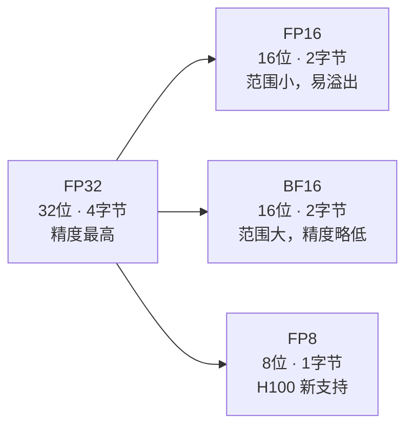
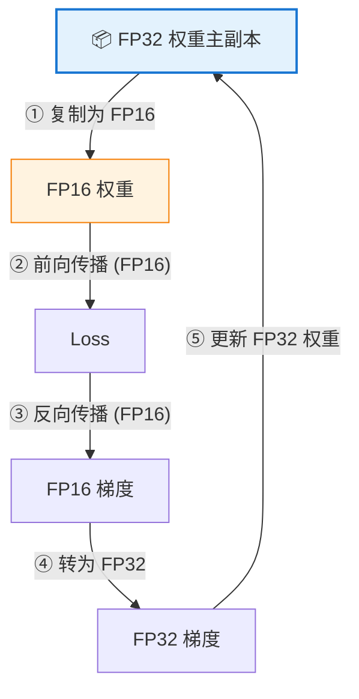

# 混合精度训练——用一半的显存达到同样的效果

> 最简单、收益最高的优化手段：把数字精度从 32 位降到 16 位，显存减半、速度翻倍。

---

## 数值精度基础



| 格式 | 位宽 | 指数位 | 尾数位 | 数值范围 | 适用场景 |
|------|------|--------|--------|----------|----------|
| FP32 | 32 | 8 | 23 | ±3.4×10³⁸ | 权重主副本、优化器状态 |
| FP16 | 16 | 5 | 10 | ±65504 | 前向/反向计算 |
| BF16 | 16 | 8 | 7 | ±3.4×10³⁸ | 前向/反向（A100+） |
| FP8 | 8 | 4/5 | 3/2 | 更小 | H100 训练加速 |

**FP16 的问题**：范围只到 65504，梯度值经常小于 FP16 最小值（~6×10⁻⁸），导致**下溢为 0**，训练崩溃。

**BF16 的优势**：和 FP32 相同的指数位（8位），范围一样大，不需要 Loss Scaling。但需要 A100/H100 等新 GPU。

---

## 混合精度训练原理

核心思想：**计算用 FP16（快），权重主副本用 FP32（准）**。



> 前向和反向用 FP16 → 速度快、显存省。权重更新用 FP32 → 精度不丢失。

---

## Loss Scaling：解决 FP16 梯度下溢


```python
# PyTorch AMP 完整训练循环
import torch
from torch.cuda.amp import autocast, GradScaler

model = MyModel().cuda()
optimizer = torch.optim.AdamW(model.parameters(), lr=1e-4)
scaler = GradScaler()  # 动态 Loss Scaling

for batch in dataloader:
    optimizer.zero_grad()
    
    with autocast(dtype=torch.float16):  # 自动选择 FP16/FP32
        output = model(batch["input_ids"].cuda())
        loss = loss_fn(output, batch["labels"].cuda())
    
    scaler.scale(loss).backward()   # 放大 loss 再反向
    scaler.step(optimizer)          # 缩回梯度再更新
    scaler.update()                 # 动态调整 scale 因子
```

---

## BF16：更简单的选择

```python
# BF16 不需要 GradScaler，直接用
with autocast(dtype=torch.bfloat16):
    output = model(batch["input_ids"].cuda())
    loss = loss_fn(output, batch["labels"].cuda())

loss.backward()
optimizer.step()
```

**HuggingFace Trainer 中启用**：

```python
from transformers import TrainingArguments

# FP16
args = TrainingArguments(output_dir="./out", fp16=True)

# BF16（推荐，A100/H100）
args = TrainingArguments(output_dir="./out", bf16=True)
```

---

## 性能收益

| 指标 | FP32 | 混合精度 (FP16/BF16) | 提升 |
|------|------|----------------------|------|
| 显存占用 | 基准 | ~50% | **节省一半** |
| 训练速度 | 基准 | 1.5-2x | **快一倍** |
| 模型精度 | 基准 | 几乎无损 | — |
| 实现难度 | — | 3 行代码 | **极低** |

> 💡 混合精度是**性价比最高**的优化，几乎零成本，所有训练都应该默认开启。

---

[⬅️ 上一篇](01-gpu-memory-basics.md) | [返回目录](README.md) | [下一篇 ➡️](03-distributed-training.md)
