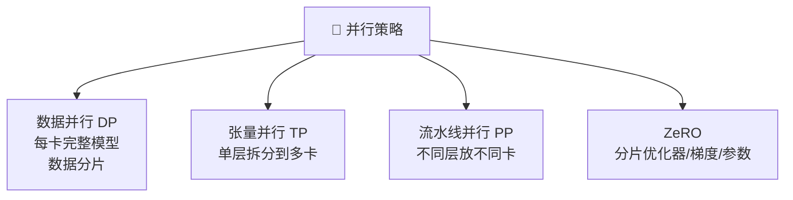
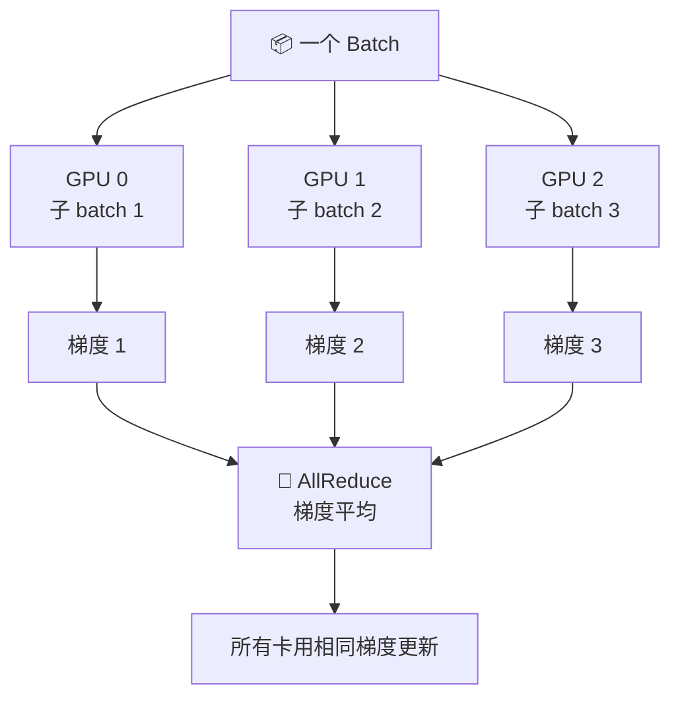
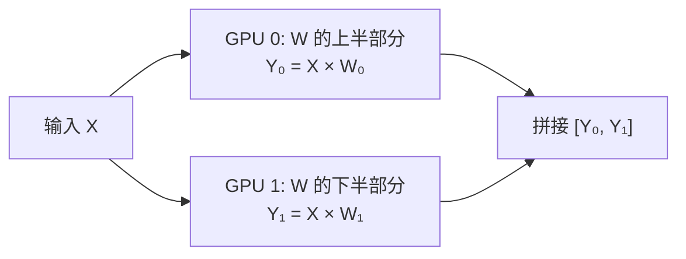
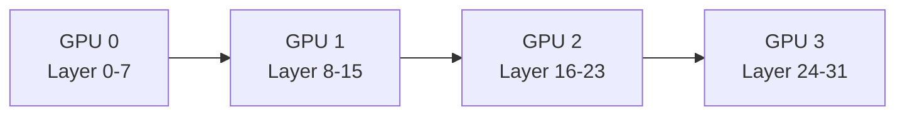
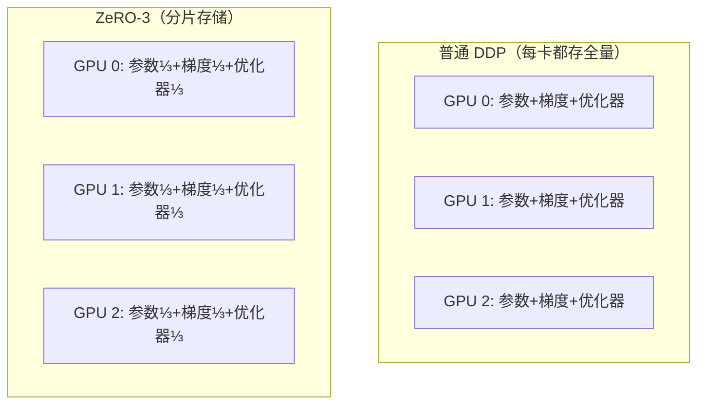
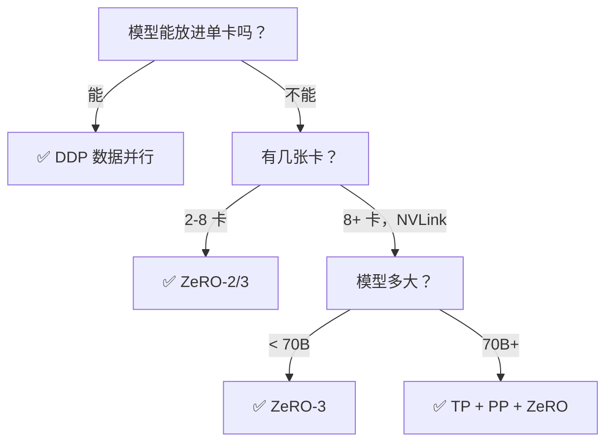

# 分布式训练——数据并行、模型并行与 ZeRO

> 单卡放不下？多卡来帮忙。理解四种并行策略和 ZeRO 优化器。

---

## 为什么需要分布式训练？

| 模型 | FP16 参数 | 训练总显存 | 单卡 A100 80GB |
|------|-----------|-----------|----------------|
| 7B | 14 GB | ~100 GB | ❌ 放不下 |
| 13B | 26 GB | ~200 GB | ❌ 放不下 |
| 70B | 140 GB | ~1 TB | ❌ 远远不够 |

---

## 四种并行策略



### 1. 数据并行 (DDP)

每张卡持有完整模型副本，数据分片到各卡，梯度 AllReduce 同步：



```python
# PyTorch DDP
import torch.distributed as dist
from torch.nn.parallel import DistributedDataParallel as DDP

dist.init_process_group("nccl")
model = DDP(model.cuda(), device_ids=[local_rank])

# 启动: torchrun --nproc_per_node=4 train.py
```

**限制**：每卡都要放完整模型，模型太大就放不下。

### 2. 张量并行 (TP)

把单个层的矩阵拆分到多张卡上并行计算：



适合超大模型（70B+），但卡间通信频繁，需要 NVLink 高速互联。

### 3. 流水线并行 (PP)

不同层放在不同卡上，数据像流水线一样流过：



**问题**：流水线气泡——前面的卡在等后面的卡算完，GPU 利用率低。通过 micro-batch 切分可以缓解。

---

## ZeRO：最实用的分布式方案

ZeRO 的核心思想：**数据并行的框架，但把冗余的显存分片到各卡**。



| 阶段 | 分片内容 | 显存节省 | 通信开销 |
|------|----------|----------|----------|
| ZeRO-1 | 优化器状态 | ~4x | 低 |
| ZeRO-2 | + 梯度 | ~8x | 中 |
| ZeRO-3 | + 模型参数 | ~N 倍（N=GPU数） | 高 |

---

## DeepSpeed 实战

```json
// deepspeed_zero2.json
{
    "bf16": {"enabled": true},
    "zero_optimization": {
        "stage": 2,
        "offload_optimizer": {"device": "cpu"},
        "allgather_partitions": true,
        "reduce_scatter": true
    },
    "gradient_accumulation_steps": 4,
    "gradient_clipping": 1.0,
    "train_batch_size": "auto",
    "train_micro_batch_size_per_gpu": "auto"
}
```

```bash
# 启动
deepspeed --num_gpus=4 train.py --deepspeed deepspeed_zero2.json
```

**HuggingFace Trainer 集成**：

```python
args = TrainingArguments(
    output_dir="./out",
    deepspeed="deepspeed_zero2.json",
    bf16=True,
    per_device_train_batch_size=2,
    gradient_accumulation_steps=4,
)
```

## FSDP（PyTorch 原生方案）

```python
args = TrainingArguments(
    output_dir="./out",
    fsdp="full_shard auto_wrap",
    fsdp_config={"fsdp_transformer_layer_cls_to_wrap": "LlamaDecoderLayer"},
    bf16=True,
)
```

---

## 策略选择指南



---

[⬅️ 上一篇](02-mixed-precision.md) | [返回目录](README.md) | [下一篇 ➡️](04-memory-optimization.md)
