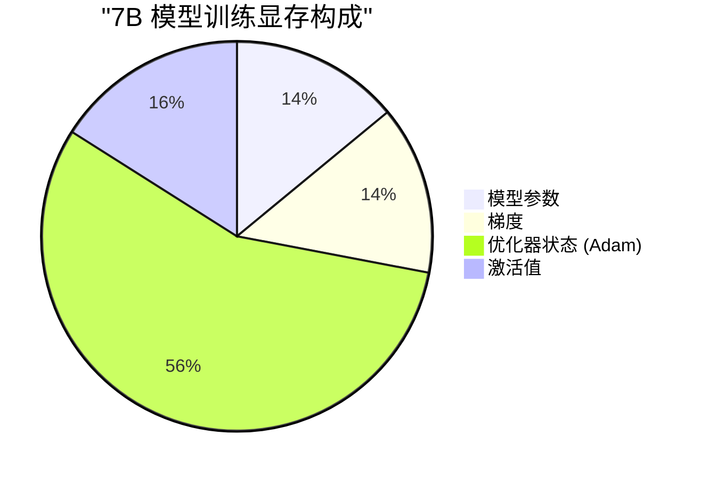
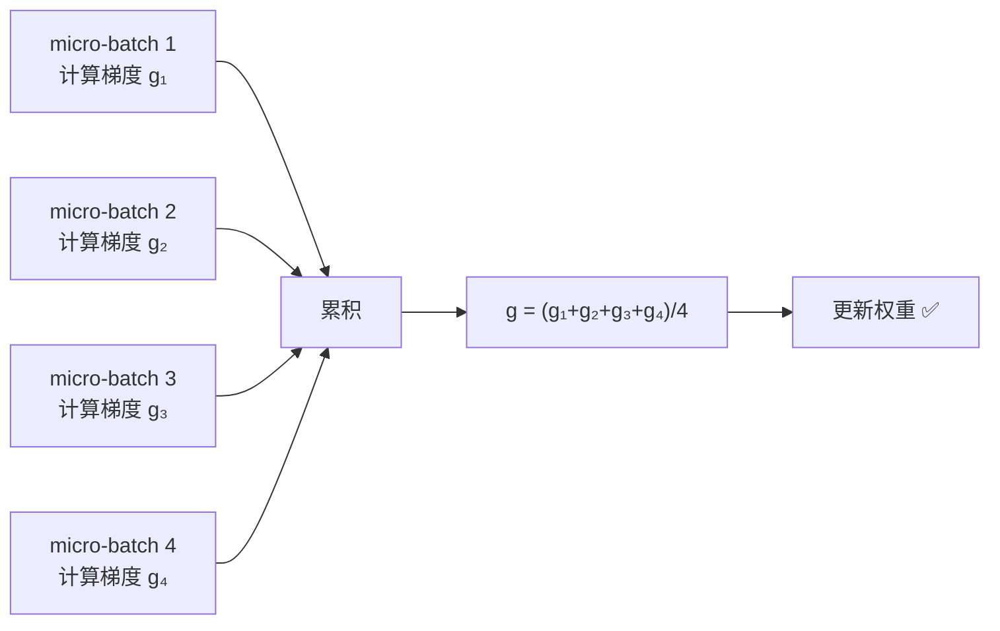
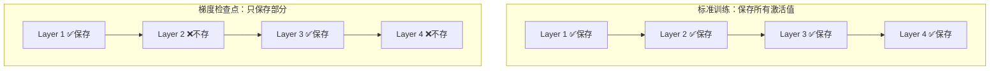

# 显存优化技术——梯度累积、梯度检查点、Offload

> 显存不够用？这三板斧帮你在有限显存上训练更大的模型。

---

## 显存瓶颈回顾



三种技术分别针对不同的显存消耗：

| 技术 | 目标 | 原理 | 代价 |
|------|------|------|------|
| 梯度累积 | 减少激活值 | 小 batch 多次累积 | 无 |
| 梯度检查点 | 减少激活值 | 不存中间结果，反向时重算 | 速度慢 ~30% |
| CPU Offload | 减少优化器/参数 | 卸载到 CPU 内存 | 速度慢 ~50% |

---

## 1. 梯度累积 (Gradient Accumulation)

想用 batch_size=32 但显存只够 batch_size=4？累积 8 步再更新：



```python
accumulation_steps = 8
optimizer.zero_grad()

for i, batch in enumerate(dataloader):
    with autocast(dtype=torch.bfloat16):
        loss = model(**batch).loss / accumulation_steps  # 除以累积步数
    loss.backward()
    
    if (i + 1) % accumulation_steps == 0:
        optimizer.step()
        optimizer.zero_grad()
```

**HuggingFace 中直接配置**：

```python
args = TrainingArguments(
    per_device_train_batch_size=4,
    gradient_accumulation_steps=8,  # 等效 batch_size = 4 × 8 = 32
)
```

---

## 2. 梯度检查点 (Gradient Checkpointing)

正常训练时，前向传播的中间激活值全部保存在显存中，供反向传播使用。梯度检查点的策略：**只保存少数检查点，其余反向时重新计算**。



反向传播到 Layer 2 时，从 Layer 1 的检查点重新前向计算得到 Layer 2 的激活值。

**时间换空间**：激活值显存减少 ~60-70%，训练速度慢 ~30%。

```python
# PyTorch 原生
from torch.utils.checkpoint import checkpoint

class MyTransformerBlock(nn.Module):
    def forward(self, x):
        return checkpoint(self._forward, x, use_reentrant=False)
    
    def _forward(self, x):
        x = self.attention(x)
        x = self.ffn(x)
        return x

# HuggingFace 模型直接启用
model.gradient_checkpointing_enable()

# 或在 TrainingArguments 中
args = TrainingArguments(gradient_checkpointing=True)
```

---

## 3. CPU Offload

把优化器状态（甚至参数）卸载到 CPU 内存，用 CPU 内存换 GPU 显存：


```json
// DeepSpeed ZeRO-2 + CPU Offload
{
    "zero_optimization": {
        "stage": 2,
        "offload_optimizer": {
            "device": "cpu",
            "pin_memory": true
        }
    }
}
```

```json
// ZeRO-3 + 全部 Offload（极端省显存）
{
    "zero_optimization": {
        "stage": 3,
        "offload_optimizer": {"device": "cpu", "pin_memory": true},
        "offload_param": {"device": "cpu", "pin_memory": true}
    }
}
```

---

## 组合使用：单卡 24GB 训练 7B 模型

```python
# QLoRA + 梯度检查点 + 梯度累积 = 单卡 24GB 训练 7B
from transformers import TrainingArguments, BitsAndBytesConfig

bnb_config = BitsAndBytesConfig(
    load_in_4bit=True,
    bnb_4bit_quant_type="nf4",
    bnb_4bit_compute_dtype=torch.bfloat16,
)

args = TrainingArguments(
    output_dir="./out",
    per_device_train_batch_size=2,
    gradient_accumulation_steps=8,     # 等效 batch=16
    gradient_checkpointing=True,       # 节省激活值显存
    bf16=True,                         # 混合精度
    optim="paged_adamw_8bit",          # 8bit 优化器
)
```

**显存估算**：

| 组件 | 无优化 | 优化后 |
|------|--------|--------|
| 模型参数 | 14 GB (FP16) | ~4 GB (4-bit) |
| LoRA 参数 | — | ~0.1 GB |
| 梯度 | 14 GB | ~0.1 GB (仅 LoRA) |
| 优化器 | 56 GB | ~0.2 GB (8-bit, 仅 LoRA) |
| 激活值 | 16 GB | ~5 GB (检查点) |
| **总计** | **~100 GB** | **~10 GB** ✅ |

---

[⬅️ 上一篇](03-distributed-training.md) | [返回目录](README.md) | [下一篇 ➡️](05-attention-optimization.md)
