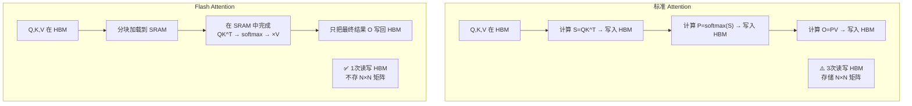
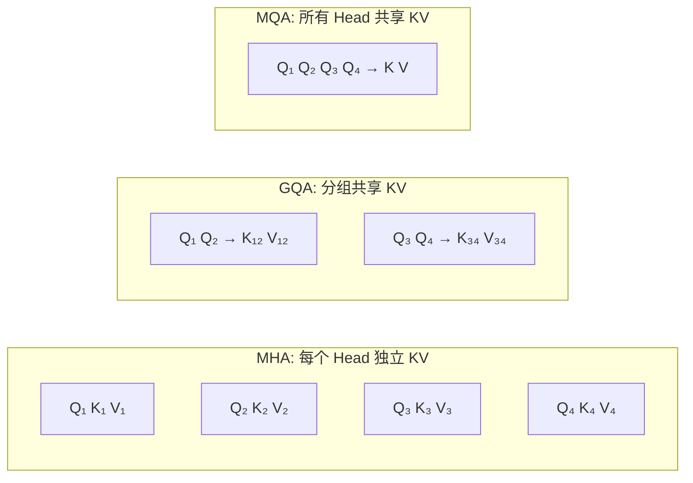
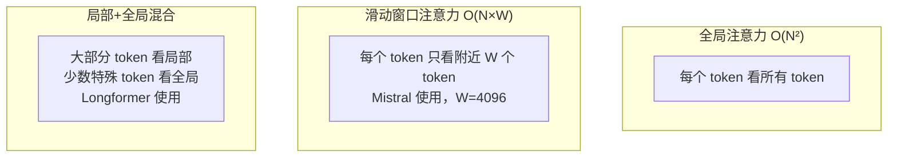
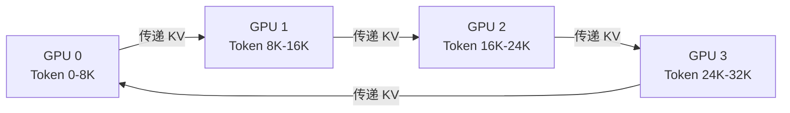

# 注意力机制优化——Flash Attention、MQA/GQA、稀疏注意力

> Attention 是 Transformer 的核心，也是最大的性能瓶颈。本篇讲解如何让它快 2-4 倍。

---

## 标准 Attention 的瓶颈

标准 Self-Attention 需要计算 N×N 的注意力矩阵（N=序列长度）：

| 序列长度 | 注意力矩阵大小 | FP16 显存 |
|----------|---------------|-----------|
| 2048 | 4M | 8 MB |
| 8192 | 67M | 128 MB |
| 32768 | 1B | 2 GB |
| 131072 | 17B | 32 GB |

显存 O(N²)，计算 O(N²)——序列越长，问题越严重。

---

## Flash Attention：IO 感知的精确注意力

**核心思想**：不在 HBM（显存）中存储 N×N 矩阵，而是分块在 SRAM（片上缓存）中计算。



**效果**：显存从 O(N²) 降到 O(N)，速度提升 2-4x。

```python
# PyTorch 2.0+ 内置支持
import torch.nn.functional as F

output = F.scaled_dot_product_attention(q, k, v, is_causal=True)
# 自动使用 Flash Attention（如果硬件支持）

# HuggingFace 模型中启用
from transformers import AutoModelForCausalLM
model = AutoModelForCausalLM.from_pretrained(
    "meta-llama/Llama-2-7b-hf",
    attn_implementation="flash_attention_2",
    torch_dtype=torch.bfloat16,
)
```

---

## MHA → MQA → GQA：减少 KV Cache



| 方案 | KV Head 数 | KV Cache 大小 | 质量 | 代表模型 |
|------|-----------|--------------|------|----------|
| MHA | = Q Head 数 | 基准 | 最好 | GPT-3 |
| GQA | Q Head / 组数 | 基准 / 组数 | 接近 MHA | LLaMA 2 70B, Qwen2 |
| MQA | 1 | 基准 / H | 略降 | PaLM, Falcon |

> GQA 是目前主流选择：KV Cache 减少到 1/4~1/8，质量几乎无损。

---

## 稀疏注意力

不是每个 token 都需要关注所有其他 token：



**Sliding Window Attention**（Mistral 使用）：

```python
# 窗口大小 W=4096，每个 token 只关注前后 4096 个 token
# 通过多层叠加，信息仍然可以传播到很远
# 第 L 层的有效感受野 = L × W
# 32 层 × 4096 窗口 = 131072 的有效上下文
```

---

## Ring Attention：分布式长上下文

将超长序列分片到多张卡上，每张卡只处理一段，通过环形通信传递 KV：



> 4 张卡 × 32K 上下文 = 支持 128K 上下文，每张卡的显存需求不变。

---

## 各优化技术总结

| 技术 | 优化目标 | 效果 | 适用阶段 |
|------|----------|------|----------|
| Flash Attention | 减少 HBM 访问 | 速度 2-4x，显存 O(N) | 训练+推理 |
| GQA | 减少 KV 参数 | KV Cache 减少 4-8x | 推理为主 |
| 滑动窗口 | 减少计算量 | 复杂度 O(NW) | 训练+推理 |
| Ring Attention | 分布式长上下文 | 线性扩展上下文长度 | 训练 |

---

[⬅️ 上一篇](04-memory-optimization.md) | [返回目录](README.md) | [下一篇 ➡️](06-quantization.md)
