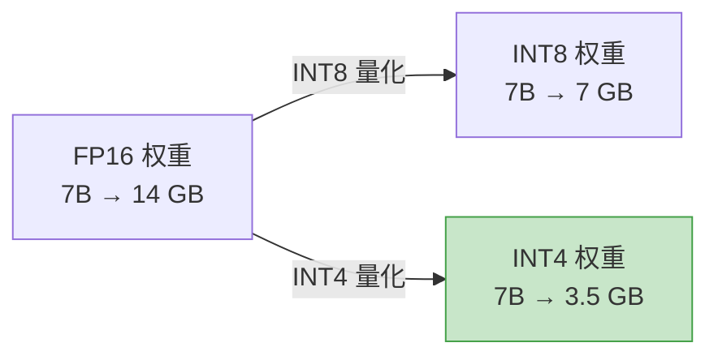
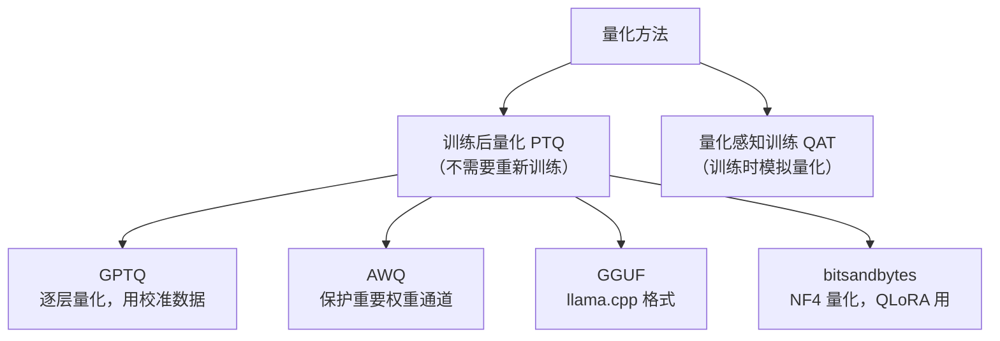
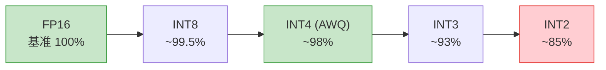

# 模型量化——从 FP32 到 INT4 的压缩之路

> 把模型从 14GB 压缩到 4GB，推理速度还更快——量化是部署大模型的必备技能。

---

## 什么是量化？

将模型权重从高精度（FP32/FP16）转换为低精度（INT8/INT4），减少存储和计算量。



---

## 量化原理：把浮点数映射为整数

```python
# 最简单的对称量化
def quantize_symmetric(tensor, bits=8):
    """将 FP16 tensor 量化为 INT8"""
    qmax = 2 ** (bits - 1) - 1  # 127
    scale = tensor.abs().max() / qmax
    quantized = torch.round(tensor / scale).clamp(-qmax, qmax).to(torch.int8)
    return quantized, scale

def dequantize(quantized, scale):
    """反量化：INT8 → FP16"""
    return quantized.float() * scale

# 示例
w = torch.randn(4096, 4096, dtype=torch.float16)
w_int8, scale = quantize_symmetric(w, bits=8)
w_restored = dequantize(w_int8, scale)
error = (w.float() - w_restored).abs().mean()
print(f"量化误差: {error:.6f}")
```

---

## 主流量化方法



| 方法 | 精度 | 速度 | 特点 | 适用场景 |
|------|------|------|------|----------|
| GPTQ | ⭐⭐⭐⭐ | 快（GPU） | 需要校准数据 | GPU 推理 |
| AWQ | ⭐⭐⭐⭐⭐ | 快（GPU） | 保护重要通道 | GPU 推理（推荐） |
| GGUF | ⭐⭐⭐⭐ | 中（CPU/GPU） | 灵活量化级别 | CPU/边缘推理 |
| bitsandbytes | ⭐⭐⭐⭐ | 中 | NF4 量化 | QLoRA 微调 |

---

## AWQ 量化实战

```python
from awq import AutoAWQForCausalLM
from transformers import AutoTokenizer

model_path = "Qwen/Qwen2-7B-Instruct"
model = AutoAWQForCausalLM.from_pretrained(model_path)
tokenizer = AutoTokenizer.from_pretrained(model_path)

# 量化（需要几分钟）
model.quantize(tokenizer, quant_config={"zero_point": True, "q_group_size": 128, "w_bit": 4})
model.save_quantized("qwen2-7b-awq")
```

## GPTQ 量化实战

```python
from transformers import AutoModelForCausalLM, GPTQConfig

config = GPTQConfig(bits=4, dataset="c4", group_size=128)
model = AutoModelForCausalLM.from_pretrained(
    "Qwen/Qwen2-7B-Instruct",
    quantization_config=config,
    device_map="auto",
)
model.save_pretrained("qwen2-7b-gptq")
```

## GGUF 量化（llama.cpp）

```bash
# 转换 + 量化
python convert_hf_to_gguf.py ./model --outfile model-f16.gguf --outtype f16
./llama-quantize model-f16.gguf model-q4_k_m.gguf Q4_K_M
```

| GGUF 级别 | 7B 大小 | 质量 | 推荐度 |
|-----------|---------|------|--------|
| Q8_0 | ~7 GB | ⭐⭐⭐⭐⭐ | 质量优先 |
| Q5_K_M | ~5 GB | ⭐⭐⭐⭐ | 均衡 |
| Q4_K_M | ~4 GB | ⭐⭐⭐⭐ | **日常推荐** |
| Q3_K_M | ~3 GB | ⭐⭐⭐ | 显存紧张 |
| Q2_K | ~2.5 GB | ⭐⭐ | 极端压缩 |

---

## W4A16 vs W8A8 vs W4A4

| 方案 | 权重精度 | 激活精度 | 说明 |
|------|----------|----------|------|
| W4A16 | INT4 | FP16 | 权重量化，计算时反量化。GPTQ/AWQ 用 |
| W8A8 | INT8 | INT8 | 权重和激活都量化。SmoothQuant 用 |
| W4A4 | INT4 | INT4 | 全量化。研究阶段 |

> W4A16 是目前最成熟的方案：权重存储用 INT4 省空间，计算时反量化为 FP16 保精度。

---

## 量化对质量的影响



> INT4 量化（AWQ/GPTQ）在大多数任务上质量损失 < 2%，是性价比最高的选择。

---

[⬅️ 上一篇](05-attention-optimization.md) | [返回目录](README.md) | [下一篇 ➡️](07-model-compression.md)
