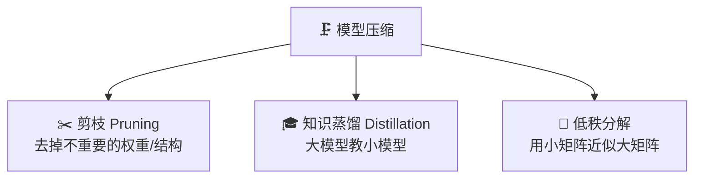
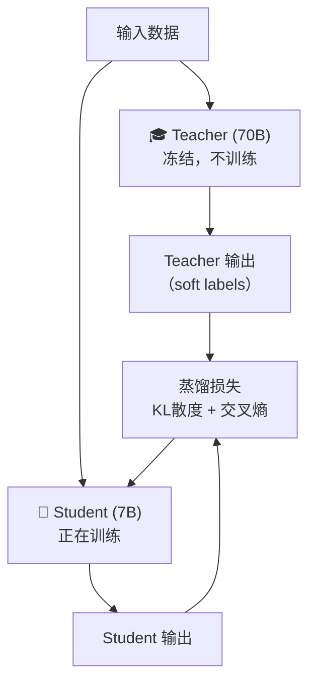
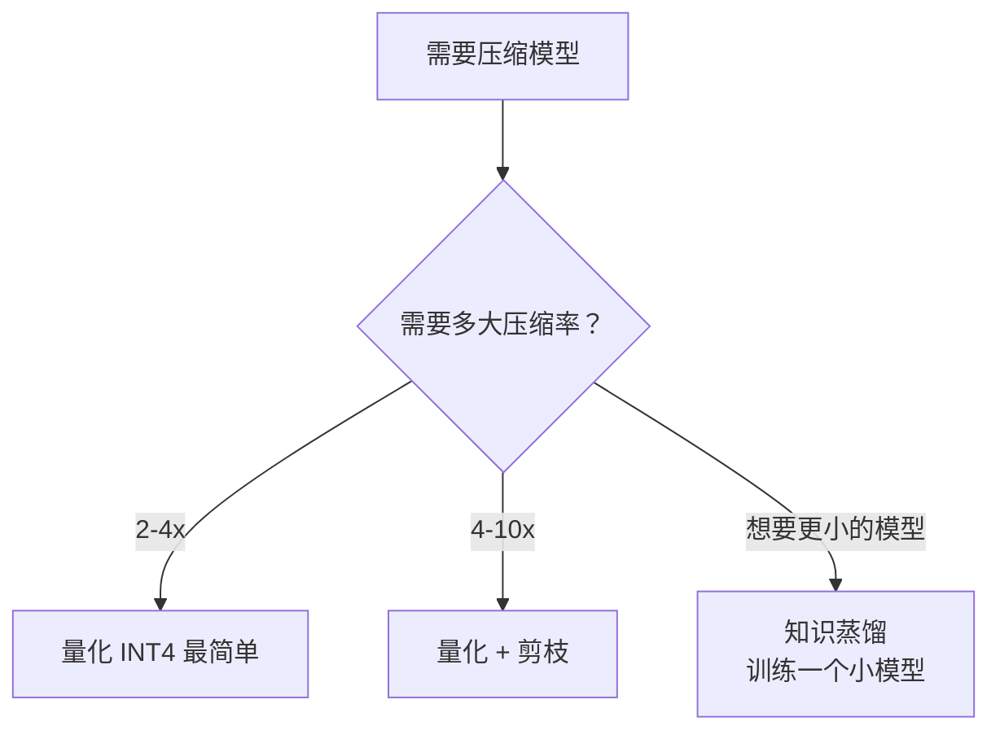

# 模型压缩——剪枝、蒸馏与低秩分解

> 量化之外的三种模型瘦身术：去掉不重要的参数、让大模型教小模型、用低秩矩阵近似。

---

## 三种压缩方法概览



| 方法 | 原理 | 压缩率 | 质量损失 | 实现难度 |
|------|------|--------|----------|----------|
| 剪枝 | 删除不重要的参数 | 2-10x | 中 | 中 |
| 蒸馏 | 训练一个更小的模型 | 任意 | 低-中 | 高 |
| 低秩分解 | 矩阵分解降维 | 2-4x | 低 | 低 |

---

## 1. 剪枝 (Pruning)

### 非结构化剪枝：把小权重置零

```python
import torch

def magnitude_pruning(weight, sparsity=0.5):
    """按绝对值大小剪枝，将最小的 50% 权重置零"""
    threshold = torch.quantile(weight.abs().float(), sparsity)
    mask = weight.abs() > threshold
    return weight * mask, mask

# 示例：50% 稀疏度
w = torch.randn(4096, 4096)
w_pruned, mask = magnitude_pruning(w, sparsity=0.5)
print(f"非零参数: {mask.sum().item() / mask.numel():.1%}")  # ~50%
```

### 结构化剪枝：删除整个注意力头/层

```python
# LLM-Pruner 风格：删除不重要的注意力头
def compute_head_importance(model, dataloader):
    """计算每个注意力头的重要性"""
    head_importance = {}
    for name, param in model.named_parameters():
        if "q_proj" in name or "k_proj" in name:
            head_importance[name] = param.data.abs().mean().item()
    return head_importance

# 删除重要性最低的 25% 的头
```

> **结构化剪枝**更实用——非结构化剪枝虽然理论压缩率高，但稀疏矩阵在 GPU 上很难加速。

---

## 2. 知识蒸馏 (Knowledge Distillation)

用大模型（Teacher）的输出来训练小模型（Student）：



```python
import torch.nn.functional as F

def distillation_loss(student_logits, teacher_logits, labels, temperature=2.0, alpha=0.5):
    """蒸馏损失 = α × 硬标签损失 + (1-α) × 软标签损失"""
    hard_loss = F.cross_entropy(student_logits, labels)
    
    student_soft = F.log_softmax(student_logits / temperature, dim=-1)
    teacher_soft = F.softmax(teacher_logits / temperature, dim=-1)
    soft_loss = F.kl_div(student_soft, teacher_soft, reduction="batchmean") * (temperature ** 2)
    
    return alpha * hard_loss + (1 - alpha) * soft_loss
```

### 更实用的方式：数据蒸馏

不需要同时加载两个模型，而是先用大模型生成数据，再用数据训练小模型：


> Alpaca、Vicuna、OpenHermes 等模型都是通过数据蒸馏训练的。

---

## 3. 低秩分解 (Low-Rank Factorization)

将大矩阵分解为两个小矩阵的乘积（和 LoRA 的思想一致）：

```
原始矩阵: W (4096 × 4096) = 16M 参数
低秩分解: W ≈ A × B, A (4096 × 256), B (256 × 4096) = 2M 参数
压缩率: 8x
```

```python
import torch

def low_rank_approximation(weight, rank=256):
    """SVD 低秩近似"""
    U, S, Vh = torch.linalg.svd(weight.float(), full_matrices=False)
    # 只保留前 rank 个奇异值
    U_r = U[:, :rank]
    S_r = torch.diag(S[:rank])
    Vh_r = Vh[:rank, :]
    
    W_approx = U_r @ S_r @ Vh_r
    error = (weight.float() - W_approx).norm() / weight.float().norm()
    compression = weight.numel() / (U_r.numel() + S_r.numel() + Vh_r.numel())
    print(f"秩={rank}, 压缩率={compression:.1f}x, 相对误差={error:.4f}")
    return (U_r @ S_r).to(weight.dtype), Vh_r.to(weight.dtype)

w = torch.randn(4096, 4096, dtype=torch.float16)
A, B = low_rank_approximation(w, rank=256)
```

---

## 方法对比与选择



| 场景 | 推荐方案 |
|------|----------|
| 快速部署，质量优先 | AWQ INT4 量化 |
| 极端压缩 | INT4 量化 + 结构化剪枝 |
| 需要特定大小的模型 | 知识蒸馏训练小模型 |
| 微调场景 | LoRA（本质是低秩分解） |

---

[⬅️ 上一篇](06-quantization.md) | [返回目录](README.md) | [下一篇 ➡️](08-inference-acceleration.md)
