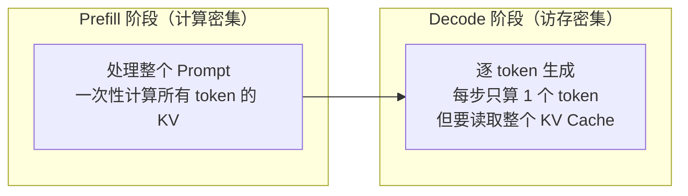
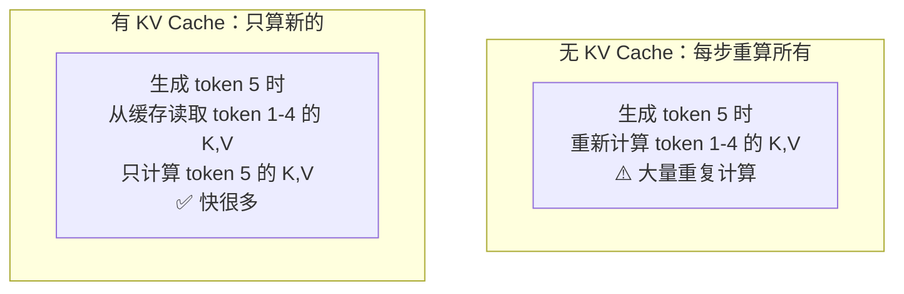
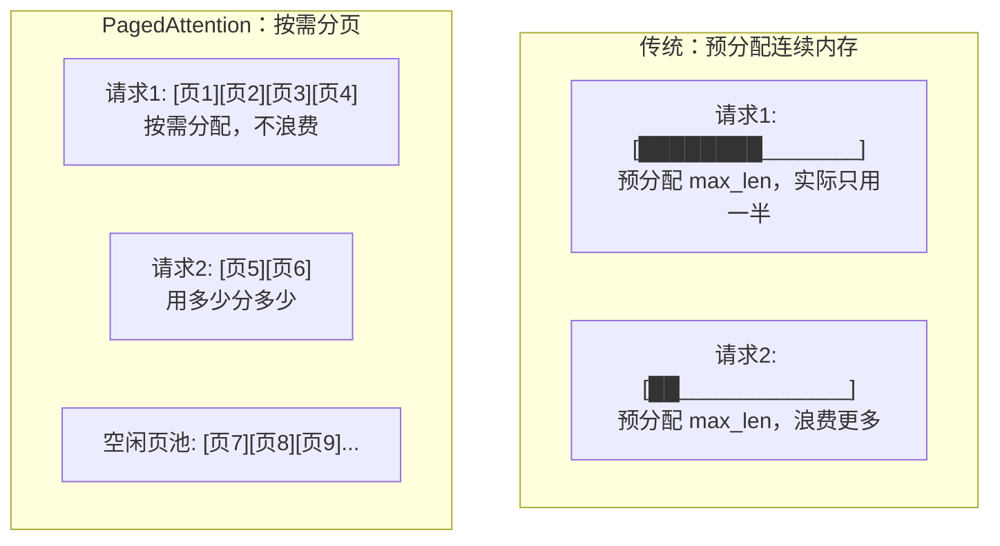
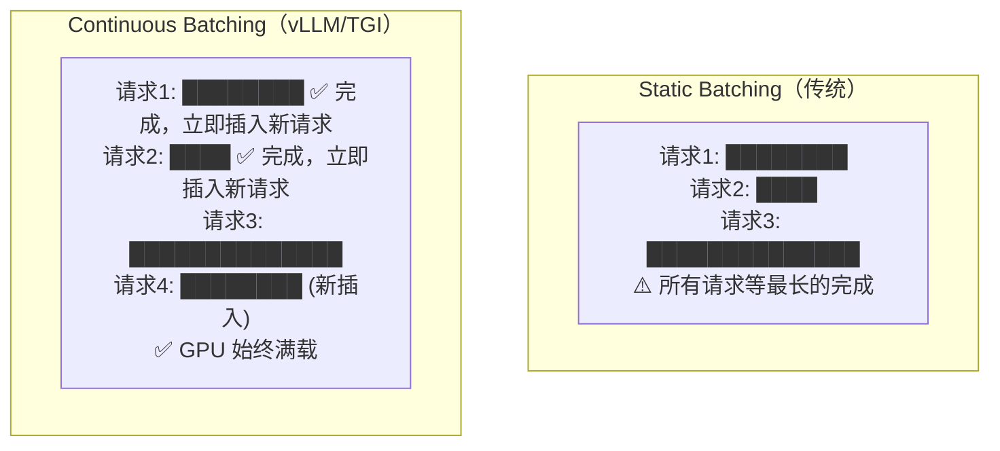
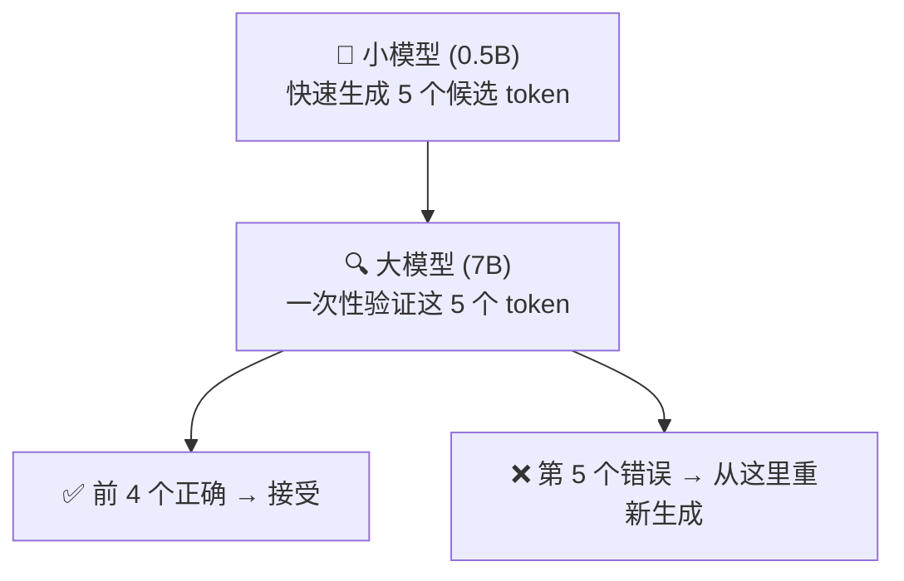
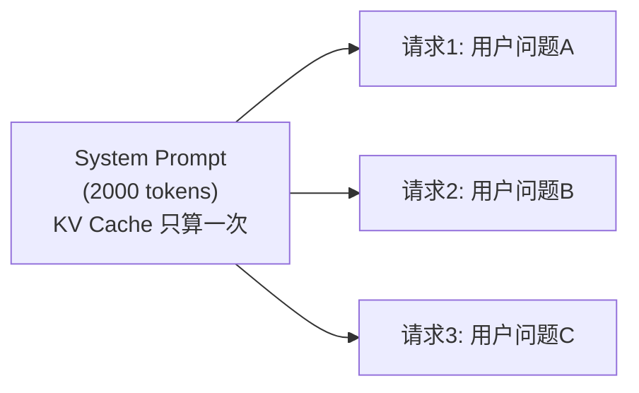

# 推理加速——KV Cache、Continuous Batching、Speculative Decoding

> 训练只做一次，推理要做无数次。推理优化直接影响成本和用户体验。

---

## LLM 推理的两个阶段



| 阶段 | 瓶颈 | 优化方向 |
|------|------|----------|
| Prefill | 计算量（FLOPs） | 张量并行、Flash Attention |
| Decode | 显存带宽 | KV Cache 优化、量化、批处理 |

---

## 1. KV Cache：空间换时间

自回归生成时，每个新 token 都需要和之前所有 token 做 Attention。如果每次都重新计算，浪费巨大。

**KV Cache**：缓存已计算的 Key 和 Value，每步只计算新 token 的 Q/K/V。



**KV Cache 显存估算**：

```python
def kv_cache_memory(n_layers, n_kv_heads, head_dim, seq_len, batch_size, dtype_bytes=2):
    """KV Cache 显存 = 2 × layers × kv_heads × head_dim × seq_len × batch × dtype"""
    mem = 2 * n_layers * n_kv_heads * head_dim * seq_len * batch_size * dtype_bytes
    print(f"KV Cache: {mem / 1e9:.2f} GB")
    return mem

# LLaMA-2 7B, batch=16, seq=4096
kv_cache_memory(32, 32, 128, 4096, 16)  # ~32 GB！
# 用 GQA (4 KV heads) 后
kv_cache_memory(32, 4, 128, 4096, 16)   # ~4 GB ✅
```

---

## 2. PagedAttention：KV Cache 的内存管理

传统方式为每个请求预分配最大长度的 KV Cache → 显存浪费严重。

**PagedAttention**（vLLM 核心）：像操作系统管理内存一样管理 KV Cache。



> 显存利用率从 ~50% 提升到 ~95%，同样显存能服务更多并发请求。

---

## 3. Continuous Batching：动态批处理



| 方式 | GPU 利用率 | 吞吐量 |
|------|-----------|--------|
| Static Batching | ~30-50% | 基准 |
| Continuous Batching | ~90-95% | **2-3x** |

---

## 4. Speculative Decoding：投机解码

用小模型快速"猜"多个 token，大模型一次性验证：



**关键洞察**：大模型验证 5 个 token 的成本 ≈ 生成 1 个 token（并行计算），所以如果接受率高，速度提升显著。

```python
# HuggingFace 中使用 Speculative Decoding
from transformers import AutoModelForCausalLM

# 大模型（target）
model = AutoModelForCausalLM.from_pretrained("Qwen/Qwen2-7B-Instruct")
# 小模型（draft）
assistant = AutoModelForCausalLM.from_pretrained("Qwen/Qwen2-0.5B-Instruct")

outputs = model.generate(
    input_ids,
    assistant_model=assistant,
    max_new_tokens=200,
)
```

| 场景 | 接受率 | 加速比 |
|------|--------|--------|
| 代码生成 | ~80% | 2-3x |
| 翻译 | ~70% | 2x |
| 创意写作 | ~50% | 1.3-1.5x |

---

## 5. Prefix Caching

多个请求共享相同的 System Prompt 时，缓存其 KV Cache：



> 100 个请求共享 2000 token 的 System Prompt → 节省 99% 的 Prefill 计算。

---

## 各技术组合效果

| 技术 | 优化目标 | 效果 |
|------|----------|------|
| KV Cache | 避免重复计算 | 必备，10x+ |
| GQA | 减少 KV Cache 大小 | 4-8x 显存 |
| PagedAttention | 提高显存利用率 | 2x 并发 |
| Continuous Batching | 提高 GPU 利用率 | 2-3x 吞吐 |
| Speculative Decoding | 减少 Decode 步数 | 1.5-3x 延迟 |
| INT4 量化 | 减少模型+KV 大小 | 2-4x 显存 |
| Prefix Caching | 复用公共前缀 | 场景相关 |

---

[⬅️ 上一篇](07-model-compression.md) | [返回目录](README.md) | [下一篇 ➡️](09-inference-engines.md)
