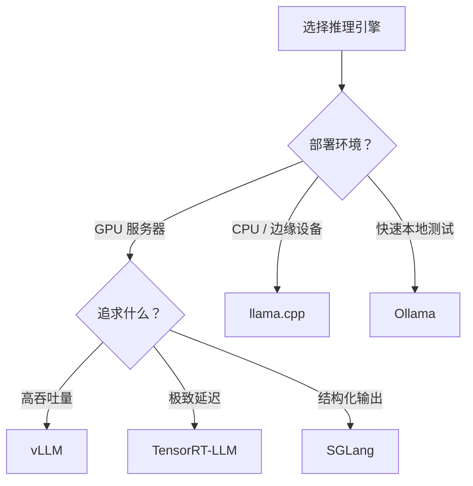

# 推理引擎实战——vLLM、TensorRT-LLM、llama.cpp、SGLang

> 理论讲完了，这篇全是实战：用主流推理引擎部署大模型，对比性能。

---

## 推理引擎选型



| 引擎 | 核心优化 | 适用场景 | 易用性 |
|------|----------|----------|--------|
| **vLLM** | PagedAttention + Continuous Batching | 高并发 GPU 推理 | ⭐⭐⭐⭐⭐ |
| **TensorRT-LLM** | NVIDIA 深度优化 kernel | 极致性能 | ⭐⭐⭐ |
| **SGLang** | RadixAttention + 结构化生成 | 复杂 prompt 场景 | ⭐⭐⭐⭐ |
| **llama.cpp** | CPU 优化 + GGUF 量化 | CPU/边缘设备 | ⭐⭐⭐⭐ |
| **Ollama** | 封装 llama.cpp | 本地一键部署 | ⭐⭐⭐⭐⭐ |

---

## 1. vLLM：高吞吐量首选

```bash
pip install vllm

# 启动 OpenAI 兼容 API
python -m vllm.entrypoints.openai.api_server \
    --model Qwen/Qwen2-7B-Instruct \
    --tensor-parallel-size 1 \
    --gpu-memory-utilization 0.9 \
    --max-model-len 8192 \
    --enable-prefix-caching \
    --max-num-seqs 256
```

```python
# 客户端调用
from openai import OpenAI
client = OpenAI(base_url="http://localhost:8000/v1", api_key="not-needed")

response = client.chat.completions.create(
    model="Qwen/Qwen2-7B-Instruct",
    messages=[{"role": "user", "content": "什么是 KV Cache？"}],
    max_tokens=500,
)
print(response.choices[0].message.content)
```

**vLLM 高级配置**：

```bash
# 多卡张量并行
--tensor-parallel-size 2

# AWQ 量化模型
--quantization awq

# KV Cache FP8 量化（省显存）
--kv-cache-dtype fp8

# 投机解码
--speculative-model Qwen/Qwen2-0.5B-Instruct --num-speculative-tokens 5
```

---

## 2. TensorRT-LLM：NVIDIA 极致性能

```bash
# 安装（推荐用 Docker）
docker pull nvcr.io/nvidia/tritonserver:24.07-trtllm-python-py3

# 转换模型
python convert_checkpoint.py \
    --model_dir ./Qwen2-7B-Instruct \
    --output_dir ./trt_ckpt \
    --dtype float16

# 构建引擎
trtllm-build \
    --checkpoint_dir ./trt_ckpt \
    --output_dir ./trt_engine \
    --gemm_plugin float16 \
    --max_batch_size 64 \
    --max_input_len 4096 \
    --max_seq_len 8192
```

> TensorRT-LLM 性能通常比 vLLM 快 20-50%，但部署复杂度高很多。适合追求极致性能的生产环境。

---

## 3. llama.cpp：CPU 和边缘设备

```bash
# 编译
git clone https://github.com/ggerganov/llama.cpp && cd llama.cpp && make

# 运行 GGUF 模型
./llama-cli -m qwen2-7b-instruct-q4_k_m.gguf \
    -p "解释什么是 Flash Attention" \
    -n 256 --temp 0.7 -ngl 35  # -ngl: GPU offload 层数

# 启动 API 服务
./llama-server -m model.gguf --host 0.0.0.0 --port 8080
```

```python
# Python 绑定
from llama_cpp import Llama

llm = Llama(model_path="model-q4_k_m.gguf", n_ctx=4096, n_gpu_layers=35)
output = llm.create_chat_completion(
    messages=[{"role": "user", "content": "你好"}],
    max_tokens=200,
)
print(output["choices"][0]["message"]["content"])
```

---

## 4. SGLang：结构化生成加速

SGLang 的 RadixAttention 对共享前缀的缓存更激进，特别适合多轮对话和结构化输出：

```bash
pip install sglang[all]

python -m sglang.launch_server \
    --model Qwen/Qwen2-7B-Instruct \
    --port 8000
```

---

## 5. Ollama：本地一键部署

```bash
# 安装
curl -fsSL https://ollama.com/install.sh | sh

# 下载并运行
ollama run qwen2:7b

# API 调用
curl http://localhost:11434/api/chat -d '{
  "model": "qwen2:7b",
  "messages": [{"role": "user", "content": "你好"}],
  "stream": false
}'
```

---

## 性能基准测试

```python
"""简单的推理性能测试"""
import time, asyncio
from openai import AsyncOpenAI

async def benchmark(url, model, n=50, max_tokens=256):
    client = AsyncOpenAI(base_url=url, api_key="x")
    
    async def one_request():
        start = time.time()
        r = await client.chat.completions.create(
            model=model,
            messages=[{"role": "user", "content": "用100字介绍机器学习"}],
            max_tokens=max_tokens,
        )
        tokens = r.usage.completion_tokens
        return tokens, time.time() - start
    
    results = await asyncio.gather(*[one_request() for _ in range(n)])
    total_tokens = sum(r[0] for r in results)
    wall_time = max(r[1] for r in results)
    avg_tps = sum(r[0]/r[1] for r in results) / n
    
    print(f"并发: {n}, 系统吞吐: {total_tokens/wall_time:.0f} tok/s, 平均延迟TPS: {avg_tps:.0f} tok/s")

asyncio.run(benchmark("http://localhost:8000/v1", "Qwen/Qwen2-7B-Instruct"))
```

**典型性能参考（A100 80GB, 7B 模型）**：

| 引擎 | 单请求 TPS | 并发 50 吞吐 | 首 Token 延迟 |
|------|-----------|-------------|--------------|
| vLLM (FP16) | ~80 tok/s | ~2000 tok/s | ~50ms |
| vLLM (AWQ INT4) | ~120 tok/s | ~3500 tok/s | ~30ms |
| TensorRT-LLM | ~150 tok/s | ~4500 tok/s | ~20ms |
| llama.cpp (GPU) | ~60 tok/s | N/A | ~80ms |

---

## 部署架构选择

| 规模 | 方案 | 配置 |
|------|------|------|
| 个人/Demo | Ollama | 单机 |
| 小团队 (<10 QPS) | vLLM 单实例 | 1-2 GPU |
| 中等 (10-100 QPS) | vLLM + Nginx 负载均衡 | 多实例 |
| 大规模 (100+ QPS) | TRT-LLM + Triton + K8s | GPU 集群 |

---

[⬅️ 上一篇](08-inference-acceleration.md) | [返回目录](README.md)
