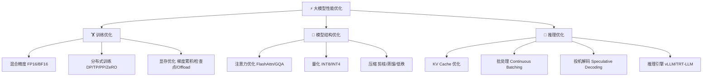

# ⚡ 大模型性能优化系列博客

> 系统讲解大模型训练与推理的性能优化技术——原理、实现、实战，从硬件基础到工程落地。

---

## 📖 博客目录

### 训练优化篇

| # | 标题 | 核心内容 |
|---|------|----------|
| 1 | [GPU 与显存基础](01-gpu-memory-basics.md) | GPU 架构、显存构成、性能瓶颈分析 |
| 2 | [混合精度训练](02-mixed-precision.md) | FP16/BF16、Loss Scaling、AMP 实战 |
| 3 | [分布式训练](03-distributed-training.md) | 数据并行、模型并行、张量并行、ZeRO |
| 4 | [显存优化技术](04-memory-optimization.md) | 梯度累积、梯度检查点、CPU Offload |

### 模型结构优化篇

| # | 标题 | 核心内容 |
|---|------|----------|
| 5 | [注意力机制优化](05-attention-optimization.md) | Flash Attention、MQA/GQA、稀疏注意力 |
| 6 | [模型量化](06-quantization.md) | INT8/INT4、GPTQ、AWQ、GGUF 量化 |
| 7 | [模型压缩](07-model-compression.md) | 剪枝、知识蒸馏、低秩分解 |

### 推理优化篇

| # | 标题 | 核心内容 |
|---|------|----------|
| 8 | [推理加速技术](08-inference-acceleration.md) | KV Cache、Continuous Batching、Speculative Decoding |
| 9 | [推理引擎实战](09-inference-engines.md) | vLLM、TensorRT-LLM、llama.cpp、SGLang |

---

## 🗺️ 技术全景图

## 📝 阅读建议

- 建议按顺序阅读，每篇都建立在前一篇的基础上
- 博客 1 是硬件基础，理解它对后续所有优化技术都有帮助
- 训练优化篇（1-4）适合需要训练/微调模型的读者
- 推理优化篇（6-9）适合需要部署模型的读者
- 每篇都包含原理讲解 + 代码实现 + 实战配置
