# 大模型训练数据集完全指南：从获取到构建

> 一篇文章讲透大模型训练数据的全流程——数据从哪来、长什么样、怎么清洗、怎么构建文本/图片/视频数据集。

---

## 📑 目录

- [1. 概述：数据是大模型的"粮食"](#1-概述数据是大模型的粮食)
- [2. 大模型训练的三个阶段与数据需求](#2-大模型训练的三个阶段与数据需求)
- [3. 文本数据集](#3-文本数据集)
  - [3.1 预训练数据：从哪获取海量文本](#31-预训练数据从哪获取海量文本)
  - [3.2 SFT 指令微调数据集](#32-sft-指令微调数据集)
  - [3.3 偏好对齐数据集（RLHF/DPO）](#33-偏好对齐数据集rlhfdpo)
- [4. 数据清洗：从"脏数据"到"高质量语料"](#4-数据清洗从脏数据到高质量语料)
- [5. 图片数据集](#5-图片数据集)
- [6. 视频数据集](#6-视频数据集)
- [7. 多模态数据集](#7-多模态数据集)
- [8. 数据合成：用 AI 生成训练数据](#8-数据合成用-ai-生成训练数据)
- [9. 数据集管理与版本控制](#9-数据集管理与版本控制)
- [10. 完整实战：从零构建一个领域数据集](#10-完整实战从零构建一个领域数据集)
- [附录：常用公开数据集速查表](#附录常用公开数据集速查表)

---

## 1. 概述：数据是大模型的"粮食"

大模型的能力上限，很大程度上由训练数据决定。业界有一句话：

> **"Garbage in, garbage out"（垃圾进，垃圾出）**

再好的模型架构，喂了低质量数据也训不出好模型。反过来，高质量数据甚至能让小模型超越大模型。

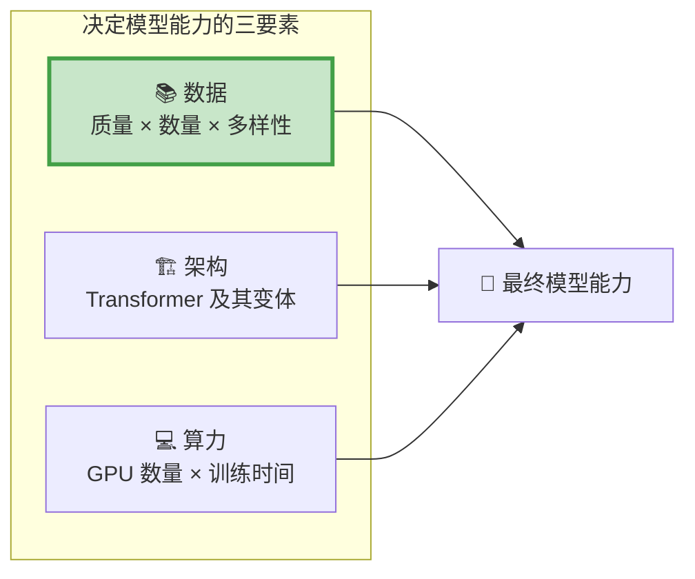

**数据的重要性排序：质量 > 多样性 > 数量。** 1000 条精心标注的数据，往往比 10 万条低质量数据更有价值。

---

## 2. 大模型训练的三个阶段与数据需求

大模型训练分三个阶段，每个阶段需要的数据类型完全不同：

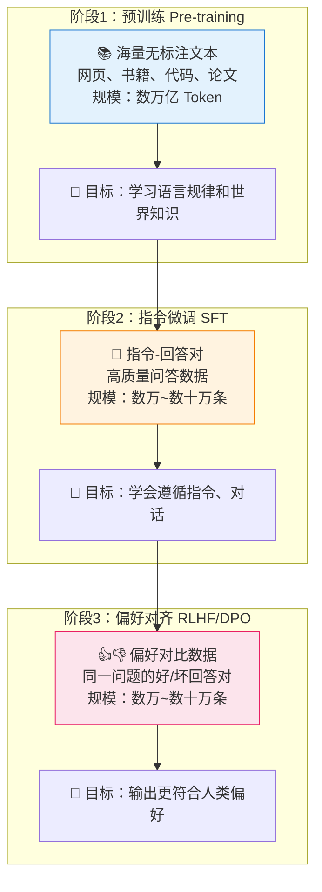

| 阶段 | 数据类型 | 数据量 | 质量要求 | 获取难度 |
|------|----------|--------|----------|----------|
| 预训练 | 无标注文本 | 万亿 Token | 中等（量大，允许噪音） | 低（公开数据多） |
| SFT | 指令-回答对 | 万~十万条 | 高（直接影响对话质量） | 中（需要标注） |
| 偏好对齐 | 好/坏回答对 | 万~十万条 | 极高（需要人类判断） | 高（需要人工标注） |

---

## 3. 文本数据集

### 3.1 预训练数据：从哪获取海量文本

#### 主要数据来源

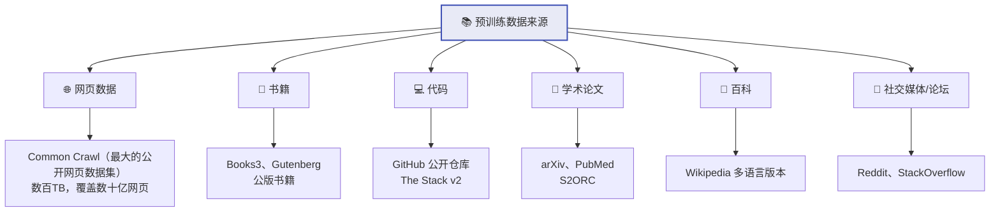

#### 主流公开预训练数据集

| 数据集 | 规模 | 语言 | 说明 |
|--------|------|------|------|
| [Common Crawl](https://commoncrawl.org/) | 数百 TB | 多语言 | 最大的公开网页爬取数据 |
| [RedPajama v2](https://together.ai/redpajama) | 30T Token | 多语言 | 开源复现 LLaMA 训练数据 |
| [The Pile](https://pile.eleuther.ai/) | 825 GB | 英文为主 | EleutherAI 整理的多源数据集 |
| [FineWeb](https://huggingface.co/datasets/HuggingFaceFW/fineweb) | 15T Token | 英文 | HuggingFace 高质量网页数据 |
| [CulturaX](https://huggingface.co/datasets/uonlp/CulturaX) | 6.3T Token | 167种语言 | 多语言清洗后数据 |
| [WuDaoCorpora](https://data.baai.ac.cn/) | 3TB | 中文 | 智源研究院中文语料 |
| [The Stack v2](https://huggingface.co/datasets/bigcode/the-stack-v2) | 67.5TB | 代码 | 600+编程语言 |
| [Wikipedia](https://dumps.wikimedia.org/) | ~20GB/语言 | 多语言 | 高质量百科全书 |

#### 预训练数据格式

预训练数据格式非常简单——纯文本，通常用 JSONL（每行一个 JSON）：

```jsonl
{"text": "自然语言处理是人工智能的一个重要分支，它研究如何让计算机理解和生成人类语言..."}
{"text": "import torch\nimport torch.nn as nn\n\nclass Transformer(nn.Module):\n    ..."}
{"text": "The Transformer architecture was introduced in the paper 'Attention Is All You Need'..."}
```

#### 数据配比策略

不同来源的数据需要合理配比，这直接影响模型的能力分布：

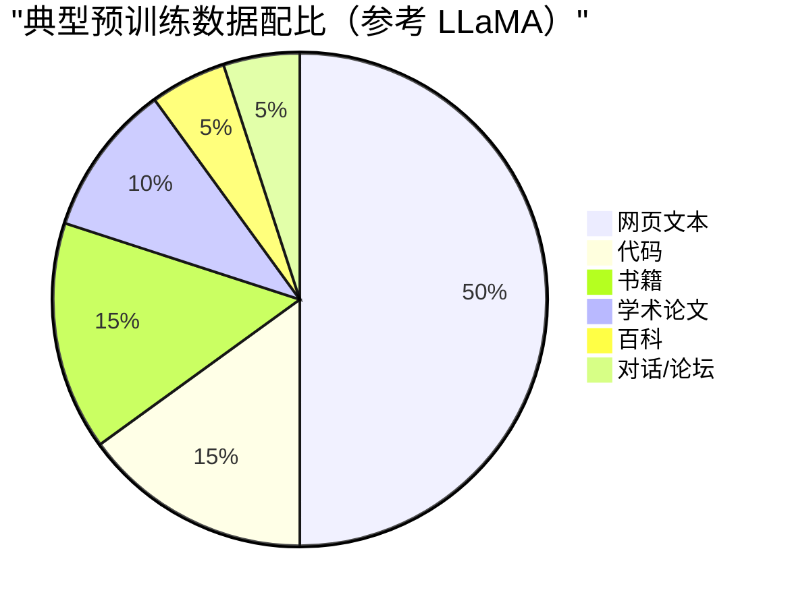

```python
# 数据配比配置示例
data_mix = {
    "web_text":   {"weight": 0.50, "path": "data/web/*.jsonl"},
    "code":       {"weight": 0.15, "path": "data/code/*.jsonl"},
    "books":      {"weight": 0.15, "path": "data/books/*.jsonl"},
    "papers":     {"weight": 0.10, "path": "data/papers/*.jsonl"},
    "wikipedia":  {"weight": 0.05, "path": "data/wiki/*.jsonl"},
    "forums":     {"weight": 0.05, "path": "data/forums/*.jsonl"},
}
```

> 💡 **配比的影响**：代码数据占比高 → 模型编程能力强；中文数据占比高 → 中文能力强。LLaMA 早期版本中文差，就是因为中文数据占比太低。


### 3.2 SFT 指令微调数据集

SFT 数据是让基座模型"学会对话"的关键。格式是"指令→回答"对。

#### 常见数据格式

**格式一：Alpaca 格式（单轮）**

```json
{
    "instruction": "请将以下英文翻译为中文",
    "input": "Machine learning is a subset of artificial intelligence.",
    "output": "机器学习是人工智能的一个子集。"
}
```

**格式二：ShareGPT 格式（多轮对话）**

```json
{
    "conversations": [
        {"from": "human", "value": "帮我用 Python 实现快速排序"},
        {"from": "gpt", "value": "```python\ndef quicksort(arr):\n    if len(arr) <= 1:\n        return arr\n    pivot = arr[len(arr) // 2]\n    left = [x for x in arr if x < pivot]\n    middle = [x for x in arr if x == pivot]\n    right = [x for x in arr if x > pivot]\n    return quicksort(left) + middle + quicksort(right)\n```"},
        {"from": "human", "value": "能加上注释吗？"},
        {"from": "gpt", "value": "当然，以下是带注释的版本：..."}
    ]
}
```

**格式三：OpenAI Messages 格式（最通用）**

```json
{
    "messages": [
        {"role": "system", "content": "你是一个专业的翻译助手"},
        {"role": "user", "content": "翻译：Hello World"},
        {"role": "assistant", "content": "你好，世界"}
    ]
}
```

#### 主流公开 SFT 数据集

| 数据集 | 规模 | 语言 | 特点 |
|--------|------|------|------|
| [Alpaca](https://github.com/tatsu-lab/stanford_alpaca) | 52K | 英文 | GPT-3.5 生成，经典入门 |
| [ShareGPT](https://huggingface.co/datasets/anon8231489123/ShareGPT_Vicuna_unfiltered) | 90K 对话 | 多语言 | 真实用户与 ChatGPT 的对话 |
| [OpenAssistant (OASST2)](https://huggingface.co/datasets/OpenAssistant/oasst2) | 160K | 多语言 | 人工标注的多轮对话树 |
| [BELLE](https://github.com/LianjiaTech/BELLE) | 200万 | 中文 | 中文指令数据 |
| [Firefly](https://github.com/yangjianxin1/Firefly) | 160万 | 中文 | 多任务中文指令数据 |
| [OpenHermes 2.5](https://huggingface.co/datasets/teknium/OpenHermes-2.5) | 1M | 英文 | 高质量合成数据 |
| [Infinity-Instruct](https://huggingface.co/datasets/BAAI/Infinity-Instruct) | 数百万 | 中英 | 智源大规模指令数据 |

#### 自建 SFT 数据集的方法

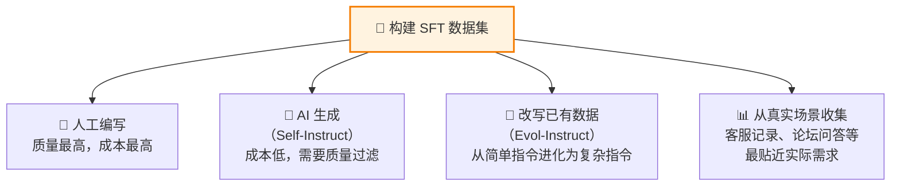

```python
"""Self-Instruct：用 GPT-4 批量生成 SFT 数据"""
from openai import OpenAI
import json

client = OpenAI()

def generate_sft_batch(domain, n=20):
    """为指定领域批量生成指令数据"""
    prompt = f"""请为"{domain}"领域生成{n}条高质量的指令微调数据。

要求：
1. 指令多样化：包含问答、分析、创作、总结、对比等不同类型
2. 难度分布：简单30%、中等50%、困难20%
3. 回答详细准确，200-800字不等
4. 输出严格的 JSON 数组

格式：
[{{"instruction": "指令内容", "input": "可选的输入上下文", "output": "详细回答"}}]"""

    response = client.chat.completions.create(
        model="gpt-4o",
        messages=[{"role": "user", "content": prompt}],
        response_format={"type": "json_object"},
        temperature=0.8,
    )
    return json.loads(response.choices[0].message.content)

# 批量生成
domains = ["Python编程", "数据分析", "机器学习", "产品设计"]
all_data = []
for domain in domains:
    batch = generate_sft_batch(domain, n=20)
    all_data.extend(batch if isinstance(batch, list) else batch.get("data", []))
    print(f"{domain}: 生成 {len(batch) if isinstance(batch, list) else 0} 条")

# 保存
with open("sft_data.jsonl", "w", encoding="utf-8") as f:
    for item in all_data:
        f.write(json.dumps(item, ensure_ascii=False) + "\n")
print(f"总计: {len(all_data)} 条")
```

### 3.3 偏好对齐数据集（RLHF/DPO）

偏好数据用于训练模型"什么样的回答更好"，格式是三元组：`(prompt, chosen, rejected)`。

#### 数据格式

```json
{
    "prompt": "如何提高英语口语水平？",
    "chosen": "提高英语口语可以从以下几个方面入手：\n\n1. **每日练习**：每天至少花30分钟进行口语练习...\n2. **影子跟读**：选择英文播客或TED演讲...\n3. **找语伴**：通过HelloTalk等App找母语者交流...\n4. **录音回听**：录下自己的口语，对比原声找差距...",
    "rejected": "多说多练就行了。"
}
```

#### 主流公开偏好数据集

| 数据集 | 规模 | 说明 |
|--------|------|------|
| [Anthropic HH-RLHF](https://huggingface.co/datasets/Anthropic/hh-rlhf) | 170K | Anthropic 的 Helpful & Harmless 数据 |
| [UltraFeedback](https://huggingface.co/datasets/openbmb/UltraFeedback) | 64K | GPT-4 标注的多维度偏好数据 |
| [Nectar](https://huggingface.co/datasets/berkeley-nest/Nectar) | 183K | 多模型回答 + GPT-4 排序 |
| [OASST2](https://huggingface.co/datasets/OpenAssistant/oasst2) | 含偏好标注 | 人工标注的对话质量排序 |

#### 构建偏好数据的方法

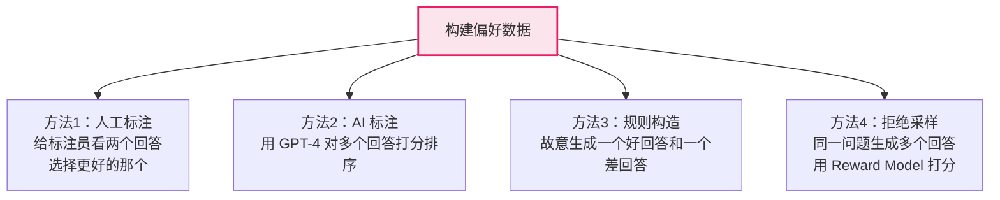

```python
"""用 GPT-4 自动构建偏好数据"""
def build_preference_pair(instruction, good_model="gpt-4o", bad_model="gpt-4o"):
    """生成一对好/坏回答"""
    # 生成高质量回答（低温度，详细指令）
    chosen_resp = client.chat.completions.create(
        model=good_model,
        messages=[
            {"role": "system", "content": "你是一个专业、详细、有帮助的助手。请给出结构化的、有深度的回答。"},
            {"role": "user", "content": instruction}
        ],
        temperature=0.3,
    )
    
    # 生成低质量回答（高温度，简单指令）
    rejected_resp = client.chat.completions.create(
        model=bad_model,
        messages=[
            {"role": "system", "content": "用一两句话简短回答。"},
            {"role": "user", "content": instruction}
        ],
        temperature=1.2,
    )
    
    return {
        "prompt": instruction,
        "chosen": chosen_resp.choices[0].message.content,
        "rejected": rejected_resp.choices[0].message.content,
    }
```


---

## 4. 数据清洗：从"脏数据"到"高质量语料"

数据清洗是整个数据管线中最关键的环节。原始数据中充满噪音、重复、有害内容，必须经过严格清洗。

### 4.1 清洗全流程

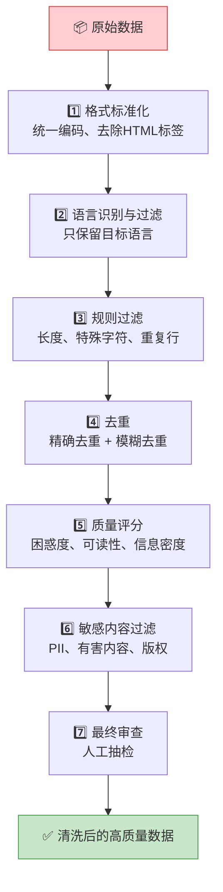

### 4.2 各步骤详解与代码

#### 步骤 1：格式标准化

```python
import re
import html
import unicodedata

def normalize_text(text):
    """文本格式标准化"""
    # 1. HTML 实体解码
    text = html.unescape(text)
    
    # 2. 去除 HTML 标签
    text = re.sub(r'<[^>]+>', '', text)
    
    # 3. Unicode 标准化（统一全角/半角等）
    text = unicodedata.normalize('NFKC', text)
    
    # 4. 统一换行符
    text = text.replace('\r\n', '\n').replace('\r', '\n')
    
    # 5. 去除多余空白
    text = re.sub(r'\n{3,}', '\n\n', text)
    text = re.sub(r' {2,}', ' ', text)
    
    return text.strip()
```

#### 步骤 2：语言识别

```python
# pip install fasttext-langdetect
from ftlangdetect import detect

def filter_by_language(text, target_langs=("zh", "en"), threshold=0.8):
    """过滤非目标语言的文本"""
    try:
        result = detect(text[:500])  # 只检测前500字符，提高速度
        return result["lang"] in target_langs and result["score"] > threshold
    except Exception:
        return False
```

#### 步骤 3：规则过滤

```python
def rule_based_filter(text, min_length=100, max_length=100000):
    """基于规则的质量过滤"""
    # 长度过滤
    if not (min_length <= len(text) <= max_length):
        return False, "length"
    
    # 特殊字符比例过高（可能是乱码）
    special_chars = len(re.findall(r'[^\w\s\u4e00-\u9fff.,!?;:，。！？；：]', text))
    if special_chars / max(len(text), 1) > 0.3:
        return False, "special_chars"
    
    # 重复行比例过高（可能是模板页面）
    lines = [l.strip() for l in text.split('\n') if l.strip()]
    if lines:
        unique_ratio = len(set(lines)) / len(lines)
        if unique_ratio < 0.3:
            return False, "duplicate_lines"
    
    # 单词重复率过高（可能是 SEO 垃圾）
    words = text.split()
    if len(words) > 50:
        unique_word_ratio = len(set(words)) / len(words)
        if unique_word_ratio < 0.1:
            return False, "word_repetition"
    
    # 包含过多 URL（可能是导航页/链接农场）
    url_count = len(re.findall(r'https?://\S+', text))
    if url_count > 10 and url_count / max(len(words), 1) > 0.1:
        return False, "too_many_urls"
    
    return True, "pass"
```

#### 步骤 4：去重（最关键的步骤之一）

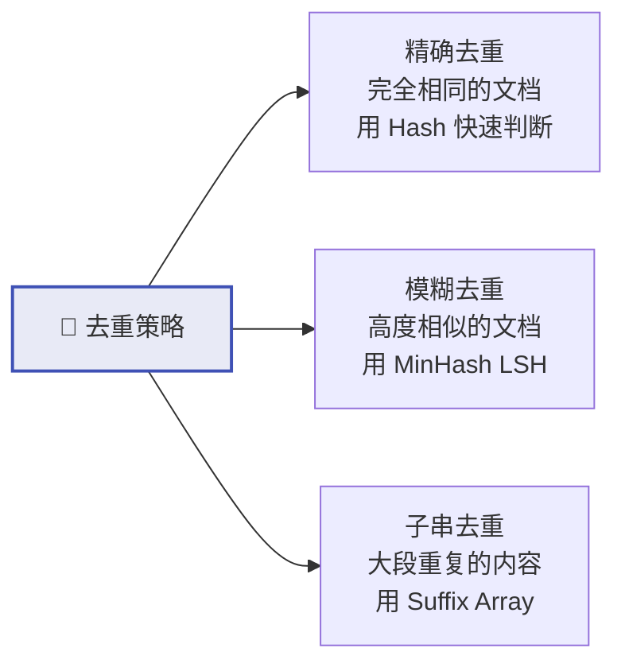

```python
import hashlib
from datasketch import MinHash, MinHashLSH

class DataDeduplicator:
    """文本去重器：支持精确去重和模糊去重"""
    
    def __init__(self, similarity_threshold=0.8):
        self.seen_hashes = set()  # 精确去重
        self.lsh = MinHashLSH(threshold=similarity_threshold, num_perm=128)
        self.doc_count = 0
    
    def _exact_hash(self, text):
        return hashlib.md5(text.encode('utf-8')).hexdigest()
    
    def _minhash(self, text, num_perm=128):
        mh = MinHash(num_perm=num_perm)
        # 用 5-gram 生成 MinHash
        for i in range(max(len(text) - 4, 1)):
            mh.update(text[i:i+5].encode('utf-8'))
        return mh
    
    def is_duplicate(self, text):
        """检查文本是否重复"""
        # 1. 精确去重
        h = self._exact_hash(text)
        if h in self.seen_hashes:
            return True
        self.seen_hashes.add(h)
        
        # 2. 模糊去重
        mh = self._minhash(text)
        if self.lsh.query(mh):
            return True
        
        self.doc_count += 1
        self.lsh.insert(f"doc_{self.doc_count}", mh)
        return False

# 使用示例
dedup = DataDeduplicator(similarity_threshold=0.8)
cleaned = [doc for doc in documents if not dedup.is_duplicate(doc["text"])]
print(f"去重前: {len(documents)}, 去重后: {len(cleaned)}, 去除: {len(documents)-len(cleaned)}")
```

#### 步骤 5：质量评分

```python
def quality_score(text):
    """综合质量评分（0-1）"""
    score = 1.0
    
    # 信息密度：有意义的词占比
    words = text.split()
    stopwords = {"的", "了", "是", "在", "和", "有", "the", "a", "is", "in", "and"}
    content_ratio = sum(1 for w in words if w not in stopwords) / max(len(words), 1)
    score *= min(content_ratio * 1.5, 1.0)
    
    # 段落结构：有合理的段落划分
    paragraphs = [p for p in text.split('\n\n') if p.strip()]
    if len(paragraphs) >= 2:
        score *= 1.0  # 有段落结构加分
    elif len(text) > 500:
        score *= 0.7  # 长文本没有段落扣分
    
    # 标点符号使用：正常文本应有合理的标点
    punct_ratio = len(re.findall(r'[.,!?;:，。！？；：]', text)) / max(len(text), 1)
    if 0.01 < punct_ratio < 0.1:
        score *= 1.0
    else:
        score *= 0.8
    
    return round(score, 3)
```

#### 步骤 6：敏感内容过滤

```python
def sensitive_content_filter(text):
    """敏感内容过滤"""
    issues = []
    
    # PII 检测（个人身份信息）
    # 手机号
    if re.search(r'1[3-9]\d{9}', text):
        issues.append("phone_number")
    # 邮箱
    if re.search(r'[\w.-]+@[\w.-]+\.\w+', text):
        issues.append("email")
    # 身份证号
    if re.search(r'\d{17}[\dXx]', text):
        issues.append("id_card")
    
    return issues

def anonymize_pii(text):
    """PII 脱敏"""
    text = re.sub(r'1[3-9]\d{9}', '<PHONE>', text)
    text = re.sub(r'[\w.-]+@[\w.-]+\.\w+', '<EMAIL>', text)
    text = re.sub(r'\d{17}[\dXx]', '<ID_CARD>', text)
    return text
```

### 4.3 完整清洗 Pipeline

```python
"""完整的数据清洗管线"""
import json
from pathlib import Path

def run_cleaning_pipeline(input_path, output_path):
    dedup = DataDeduplicator(similarity_threshold=0.8)
    
    stats = {"total": 0, "passed": 0, "reasons": {}}
    
    with open(input_path) as fin, open(output_path, "w") as fout:
        for line in fin:
            stats["total"] += 1
            item = json.loads(line)
            text = item["text"]
            
            # Step 1: 格式标准化
            text = normalize_text(text)
            
            # Step 2: 语言过滤
            if not filter_by_language(text):
                stats["reasons"]["language"] = stats["reasons"].get("language", 0) + 1
                continue
            
            # Step 3: 规则过滤
            passed, reason = rule_based_filter(text)
            if not passed:
                stats["reasons"][reason] = stats["reasons"].get(reason, 0) + 1
                continue
            
            # Step 4: 去重
            if dedup.is_duplicate(text):
                stats["reasons"]["duplicate"] = stats["reasons"].get("duplicate", 0) + 1
                continue
            
            # Step 5: 质量评分
            score = quality_score(text)
            if score < 0.3:
                stats["reasons"]["low_quality"] = stats["reasons"].get("low_quality", 0) + 1
                continue
            
            # Step 6: PII 脱敏
            text = anonymize_pii(text)
            
            # 写入清洗后的数据
            item["text"] = text
            item["quality_score"] = score
            fout.write(json.dumps(item, ensure_ascii=False) + "\n")
            stats["passed"] += 1
    
    # 输出统计
    print(f"清洗完成:")
    print(f"  总计: {stats['total']}")
    print(f"  通过: {stats['passed']} ({stats['passed']/max(stats['total'],1):.1%})")
    print(f"  过滤原因分布:")
    for reason, count in sorted(stats["reasons"].items(), key=lambda x: -x[1]):
        print(f"    {reason}: {count}")

# 运行
run_cleaning_pipeline("raw_data.jsonl", "cleaned_data.jsonl")
```

### 4.4 SFT 数据的质量检查

SFT 数据的清洗侧重点不同——更关注内容质量而非格式：

```python
def validate_sft_item(item):
    """SFT 数据质量检查"""
    issues = []
    
    instruction = item.get("instruction", "")
    output = item.get("output", "")
    
    # 指令不能太短
    if len(instruction) < 5:
        issues.append("instruction_too_short")
    
    # 回答不能太短（除非是分类任务）
    if len(output) < 20:
        issues.append("output_too_short")
    
    # 回答不能太长（可能是垃圾）
    if len(output) > 10000:
        issues.append("output_too_long")
    
    # 检查回答是否是拒绝模板（"作为AI我不能..."）
    refusal_patterns = ["作为AI", "作为一个AI", "I cannot", "I'm sorry, but"]
    if any(p in output for p in refusal_patterns):
        issues.append("refusal_response")
    
    # 检查指令和回答是否相关（简单检查：共享关键词）
    inst_words = set(instruction)
    out_words = set(output[:200])
    if len(inst_words & out_words) < 2 and len(instruction) > 10:
        issues.append("possibly_irrelevant")
    
    return issues
```


---

## 5. 图片数据集

图片数据集用于训练计算机视觉模型和多模态大模型（如 GPT-4V、Qwen-VL）。

### 5.1 图片数据集的类型

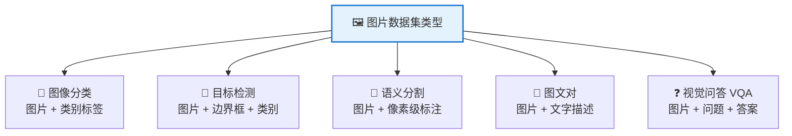

### 5.2 主流公开图片数据集

| 数据集 | 规模 | 类型 | 用途 |
|--------|------|------|------|
| [ImageNet](https://www.image-net.org/) | 1400万张 | 分类 | 图像分类基准 |
| [COCO](https://cocodataset.org/) | 33万张 | 检测/分割/描述 | 多任务视觉基准 |
| [LAION-5B](https://laion.ai/blog/laion-5b/) | 58.5亿对 | 图文对 | 训练 CLIP/Stable Diffusion |
| [LAION-400M](https://laion.ai/) | 4亿对 | 图文对 | LAION-5B 的子集 |
| [CC3M/CC12M](https://github.com/google-research-datasets/conceptual-captions) | 300万/1200万 | 图文对 | Google 概念描述 |
| [Visual Genome](https://homes.cs.washington.edu/~ranjay/visualgenome/) | 10万张 | 场景图 | 图像关系理解 |
| [LLaVA-Instruct](https://huggingface.co/datasets/liuhaotian/LLaVA-Instruct-150K) | 15万条 | 视觉指令 | 多模态指令微调 |
| [ShareGPT4V](https://sharegpt4v.github.io/) | 120万条 | 图文对话 | GPT-4V 生成的高质量描述 |

### 5.3 图片数据集格式

#### 图像分类格式

```
dataset/
├── train/
│   ├── cat/
│   │   ├── cat_001.jpg
│   │   └── cat_002.jpg
│   └── dog/
│       ├── dog_001.jpg
│       └── dog_002.jpg
└── val/
    ├── cat/
    └── dog/
```

#### 目标检测格式（COCO JSON）

```json
{
    "images": [
        {"id": 1, "file_name": "000001.jpg", "width": 640, "height": 480}
    ],
    "annotations": [
        {
            "id": 1,
            "image_id": 1,
            "category_id": 1,
            "bbox": [100, 150, 200, 300],
            "area": 60000
        }
    ],
    "categories": [
        {"id": 1, "name": "cat"},
        {"id": 2, "name": "dog"}
    ]
}
```

#### 图文对格式（多模态训练用）

```json
{"image": "images/001.jpg", "caption": "一只橘色的猫趴在阳光下的窗台上"}
{"image": "images/002.jpg", "caption": "城市夜景，高楼大厦灯火通明"}
```

#### 视觉问答/指令格式（VLM 微调用）

```json
{
    "image": "images/chart.png",
    "conversations": [
        {"from": "human", "value": "<image>\n这个柱状图显示了什么趋势？"},
        {"from": "gpt", "value": "这个柱状图显示了2020-2024年的销售额变化趋势。从图中可以看出，销售额整体呈上升趋势，其中2023年增长最为显著..."}
    ]
}
```

### 5.4 图片数据清洗

```python
from PIL import Image
import os

def clean_image_dataset(image_dir, min_size=64, max_size=10000, min_file_kb=5):
    """图片数据集清洗"""
    issues = {"corrupt": 0, "too_small": 0, "too_large": 0, "tiny_file": 0, "passed": 0}
    
    for fname in os.listdir(image_dir):
        path = os.path.join(image_dir, fname)
        
        # 文件大小检查（过小可能是损坏的）
        if os.path.getsize(path) < min_file_kb * 1024:
            issues["tiny_file"] += 1
            continue
        
        try:
            img = Image.open(path)
            img.verify()  # 验证图片完整性
            img = Image.open(path)  # 重新打开（verify 后需要重新打开）
            w, h = img.size
            
            # 尺寸检查
            if w < min_size or h < min_size:
                issues["too_small"] += 1
                continue
            if w > max_size or h > max_size:
                issues["too_large"] += 1
                continue
            
            issues["passed"] += 1
            
        except Exception:
            issues["corrupt"] += 1
    
    print(f"图片清洗结果: {issues}")
    return issues
```

### 5.5 图文对数据的质量过滤

```python
def filter_image_text_pair(caption, min_words=3, max_words=200):
    """过滤低质量的图文对"""
    # 描述太短
    words = caption.split()
    if len(words) < min_words:
        return False, "caption_too_short"
    if len(words) > max_words:
        return False, "caption_too_long"
    
    # 描述是无意义的模板文本
    bad_patterns = [
        r'^img_\d+', r'^DSC\d+', r'^image$', r'^photo$',
        r'^untitled', r'click here', r'download',
        r'^\d+×\d+',  # 只有尺寸信息
    ]
    for pattern in bad_patterns:
        if re.search(pattern, caption, re.IGNORECASE):
            return False, "template_caption"
    
    return True, "pass"
```


---

## 6. 视频数据集

视频数据集用于训练视频理解、视频生成（如 Sora）等模型。视频本质上是"带时间维度的图片序列"，数据处理更复杂。

### 6.1 视频数据集的类型

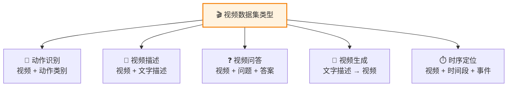

### 6.2 主流公开视频数据集

| 数据集 | 规模 | 类型 | 说明 |
|--------|------|------|------|
| [Kinetics-700](https://www.deepmind.com/open-source/kinetics) | 65万视频 | 动作识别 | 700类人类动作 |
| [WebVid-10M](https://maxbain.com/webvid-dataset/) | 1000万 | 视频-文本对 | 网络视频+描述 |
| [InternVid](https://github.com/OpenGVLab/InternVideo/tree/main/Data/InternVid) | 700万 | 视频-文本对 | 高质量视频描述 |
| [HD-VILA-100M](https://github.com/microsoft/XPretrain/tree/main/hd-vila-100m) | 1亿 | 视频-文本对 | 大规模视频语言 |
| [ActivityNet](http://activity-net.org/) | 2万视频 | 时序定位 | 日常活动理解 |
| [MSR-VTT](https://www.microsoft.com/en-us/research/publication/msr-vtt-a-large-video-description-dataset-for-bridging-video-and-language/) | 1万视频 | 视频描述 | 20万条描述 |
| [Panda-70M](https://snap-research.github.io/Panda-70M/) | 7000万 | 视频-文本对 | 高质量自动标注 |

### 6.3 视频数据格式

#### 基础格式：视频文件 + 标注 JSON

```
video_dataset/
├── videos/
│   ├── video_001.mp4
│   ├── video_002.mp4
│   └── ...
├── annotations.json
└── metadata.csv
```

#### 标注文件格式

```json
{
    "video_001.mp4": {
        "duration": 15.5,
        "fps": 30,
        "resolution": [1920, 1080],
        "caption": "一个人在厨房里做意大利面，先烧水，然后加入面条",
        "segments": [
            {"start": 0.0, "end": 5.2, "label": "烧水"},
            {"start": 5.2, "end": 12.0, "label": "煮面"},
            {"start": 12.0, "end": 15.5, "label": "装盘"}
        ]
    }
}
```

#### 视频帧提取（预处理常用操作）

```python
import cv2

def extract_frames(video_path, output_dir, fps=1):
    """从视频中按指定帧率提取帧"""
    cap = cv2.VideoCapture(video_path)
    video_fps = cap.get(cv2.CAP_PROP_FPS)
    frame_interval = int(video_fps / fps)
    
    frame_count = 0
    saved_count = 0
    
    while cap.isOpened():
        ret, frame = cap.read()
        if not ret:
            break
        if frame_count % frame_interval == 0:
            output_path = f"{output_dir}/frame_{saved_count:06d}.jpg"
            cv2.imwrite(output_path, frame)
            saved_count += 1
        frame_count += 1
    
    cap.release()
    print(f"提取了 {saved_count} 帧 (原视频 {frame_count} 帧, {video_fps:.0f} FPS)")
    return saved_count
```

### 6.4 视频数据清洗

```python
import cv2
import os

def clean_video(video_path):
    """视频质量检查"""
    issues = []
    
    cap = cv2.VideoCapture(video_path)
    if not cap.isOpened():
        return ["corrupt"]
    
    fps = cap.get(cv2.CAP_PROP_FPS)
    frame_count = int(cap.get(cv2.CAP_PROP_FRAME_COUNT))
    width = int(cap.get(cv2.CAP_PROP_FRAME_WIDTH))
    height = int(cap.get(cv2.CAP_PROP_FRAME_HEIGHT))
    duration = frame_count / max(fps, 1)
    
    # 时长检查
    if duration < 1:
        issues.append("too_short")
    if duration > 600:  # 10分钟
        issues.append("too_long")
    
    # 分辨率检查
    if width < 224 or height < 224:
        issues.append("low_resolution")
    
    # 静态视频检测（采样几帧比较差异）
    frames = []
    for i in range(0, min(frame_count, 300), max(frame_count // 5, 1)):
        cap.set(cv2.CAP_PROP_POS_FRAMES, i)
        ret, frame = cap.read()
        if ret:
            frames.append(cv2.cvtColor(frame, cv2.COLOR_BGR2GRAY))
    
    if len(frames) >= 2:
        diffs = [cv2.absdiff(frames[i], frames[i+1]).mean() for i in range(len(frames)-1)]
        if max(diffs) < 2.0:  # 几乎没有变化
            issues.append("static_video")
    
    cap.release()
    return issues
```

---

## 7. 多模态数据集

多模态数据集同时包含多种模态（文本+图片、文本+图片+音频等），用于训练多模态大模型。

### 7.1 多模态数据的组织方式

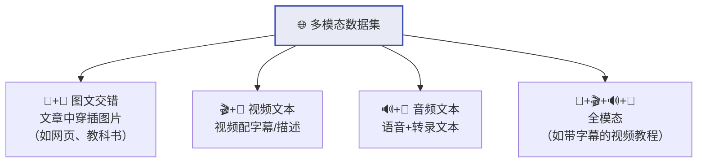

### 7.2 主流多模态数据集

| 数据集 | 模态 | 规模 | 用途 |
|--------|------|------|------|
| [LAION-5B](https://laion.ai/) | 图+文 | 58.5亿对 | CLIP/扩散模型训练 |
| [MMC4](https://github.com/allenai/mmc4) | 图文交错 | 1亿文档 | 多模态预训练 |
| [OBELICS](https://huggingface.co/datasets/HuggingFaceM4/OBELICS) | 图文交错 | 1.41亿文档 | 多模态预训练 |
| [LLaVA-Instruct-150K](https://huggingface.co/datasets/liuhaotian/LLaVA-Instruct-150K) | 图+对话 | 15万 | VLM 指令微调 |
| [Video-ChatGPT](https://github.com/mbzuai-oryx/Video-ChatGPT) | 视频+对话 | 10万 | 视频理解微调 |
| [WavCaps](https://github.com/XinhaoMei/WavCaps) | 音频+文本 | 40万 | 音频理解 |

### 7.3 多模态数据格式示例

#### 图文交错格式（用于预训练）

```json
{
    "content": [
        {"type": "text", "value": "## 如何制作提拉米苏\n\n提拉米苏是一道经典的意大利甜点。"},
        {"type": "image", "value": "images/tiramisu_ingredients.jpg"},
        {"type": "text", "value": "首先准备以下材料：马斯卡彭芝士、手指饼干、浓缩咖啡..."},
        {"type": "image", "value": "images/tiramisu_steps.jpg"},
        {"type": "text", "value": "将手指饼干浸入咖啡中，然后铺一层芝士混合物..."}
    ]
}
```

#### 视频对话格式（用于视频 LLM 微调）

```json
{
    "video": "videos/cooking_001.mp4",
    "conversations": [
        {"from": "human", "value": "<video>\n视频中的人在做什么菜？"},
        {"from": "gpt", "value": "视频中的人正在制作番茄炒蛋。他先将鸡蛋打散搅拌，然后在热锅中倒入油，将蛋液倒入翻炒至凝固后盛出，接着炒番茄，最后将鸡蛋倒回锅中一起翻炒。"},
        {"from": "human", "value": "他用了什么调料？"},
        {"from": "gpt", "value": "从视频中可以看到，他使用了盐、糖和少量酱油来调味。"}
    ]
}
```


---

## 8. 数据合成：用 AI 生成训练数据

当真实数据不足时，可以用强大的 LLM 合成训练数据。这已经成为业界主流做法。

### 8.1 数据合成方法全景

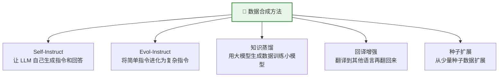

### 8.2 Evol-Instruct：渐进式难度提升

WizardLM 提出的方法，通过多轮"进化"让指令越来越复杂：

```python
def evolve_instruction(client, instruction, method="deepening"):
    """将指令进化为更复杂的版本"""
    strategies = {
        "deepening": "请将以下指令改写为更深入、需要更专业知识才能回答的版本",
        "widening": "请在以下指令基础上增加2-3个额外的约束条件或子任务",
        "reasoning": "请改写以下指令，使其需要多步推理和分析才能回答",
        "concretizing": "请将以下抽象指令改写为一个具体的、有实际场景的问题",
    }
    
    response = client.chat.completions.create(
        model="gpt-4o",
        messages=[{"role": "user", "content": f"{strategies[method]}：\n\n原始指令：{instruction}\n\n只输出进化后的指令："}],
        temperature=0.7,
    )
    return response.choices[0].message.content

# 多轮进化示例
seed = "解释什么是机器学习"
evolved = seed
for method in ["concretizing", "widening", "reasoning"]:
    evolved = evolve_instruction(client, evolved, method)
    print(f"[{method}] {evolved[:80]}...")
```

### 8.3 多模态数据合成

```python
def generate_image_qa(client, image_description):
    """根据图片描述生成视觉问答数据"""
    response = client.chat.completions.create(
        model="gpt-4o",
        messages=[{"role": "user", "content": f"""基于以下图片描述，生成3组视觉问答数据。

图片描述：{image_description}

要求：
- 问题类型多样：包含描述性、推理性、计数性问题
- 回答要详细准确
- 输出 JSON 数组格式：[{{"question": "...", "answer": "..."}}]"""}],
        response_format={"type": "json_object"},
    )
    return json.loads(response.choices[0].message.content)
```

### 8.4 合成数据的质量控制

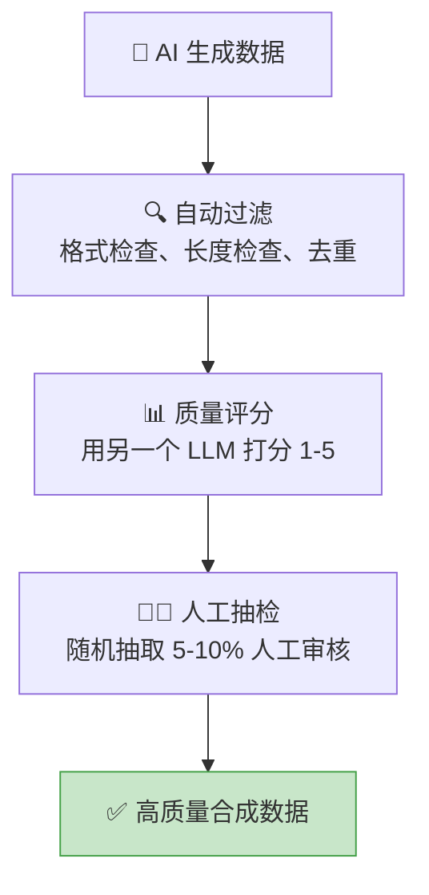

> ⚠️ **注意**：纯合成数据可能导致"模型坍缩"——模型学到的是另一个 AI 的偏见和风格。建议合成数据占比不超过 70%，混入真实数据效果更好。

---

## 9. 数据集管理与版本控制

### 9.1 使用 Hugging Face Datasets

```python
from datasets import Dataset, DatasetDict, load_dataset

# 从本地 JSONL 加载
dataset = load_dataset("json", data_files="sft_data.jsonl", split="train")

# 数据处理
dataset = dataset.filter(lambda x: len(x["output"]) > 20)  # 过滤短回答
dataset = dataset.shuffle(seed=42)  # 打乱
splits = dataset.train_test_split(test_size=0.1)  # 划分训练/验证集

# 保存
splits.save_to_disk("processed_dataset")

# 上传到 Hugging Face Hub
splits.push_to_hub("your-username/my-sft-dataset", private=True)
```

### 9.2 数据版本管理

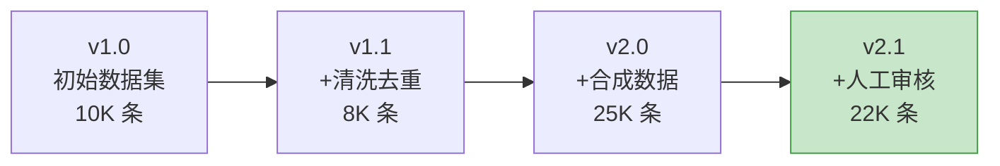

```python
# 使用 Git LFS 管理大文件
# git lfs install
# git lfs track "*.jsonl" "*.parquet"

# 数据集 metadata 记录
metadata = {
    "version": "2.1",
    "created": "2026-04-21",
    "stats": {
        "total_samples": 22000,
        "avg_instruction_length": 45,
        "avg_output_length": 320,
        "languages": {"zh": 0.6, "en": 0.4},
    },
    "changelog": [
        "v2.1: 人工审核，移除 3K 低质量样本",
        "v2.0: 新增 15K 合成数据",
        "v1.1: 去重和清洗",
        "v1.0: 初始版本",
    ]
}
```

---

## 10. 完整实战：从零构建一个领域数据集

以构建一个"Python 编程助手"的 SFT 数据集为例，走一遍完整流程：

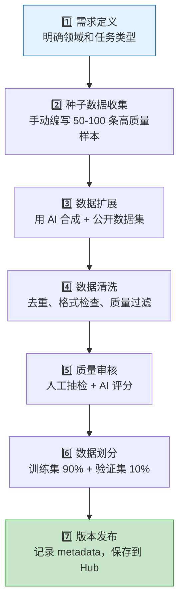

```python
"""完整实战：构建 Python 编程助手数据集"""
import json
from openai import OpenAI

client = OpenAI()

# === Step 1: 定义任务类型 ===
task_types = [
    "代码编写：根据需求写 Python 代码",
    "代码解释：解释一段代码的功能",
    "Bug 修复：找出代码中的错误并修复",
    "代码优化：优化代码的性能或可读性",
    "概念解释：解释 Python 编程概念",
]

# === Step 2: 种子数据（手动编写几条高质量样本）===
seeds = [
    {
        "instruction": "用 Python 写一个函数，判断一个字符串是否是回文",
        "output": "```python\ndef is_palindrome(s: str) -> bool:\n    \"\"\"判断字符串是否是回文\"\"\"\n    s = s.lower().replace(' ', '')\n    return s == s[::-1]\n\n# 测试\nprint(is_palindrome('racecar'))  # True\nprint(is_palindrome('hello'))    # False\n```\n\n这个函数先将字符串转为小写并去除空格，然后比较原字符串和反转后的字符串是否相同。"
    },
]

# === Step 3: AI 批量生成 ===
def generate_batch(task_type, n=10):
    resp = client.chat.completions.create(
        model="gpt-4o",
        messages=[{"role": "user", "content": f"""请生成{n}条 Python 编程助手的训练数据。
任务类型：{task_type}
要求：难度从入门到进阶，回答包含代码和解释。
输出 JSON 数组：[{{"instruction": "...", "output": "..."}}]"""}],
        response_format={"type": "json_object"},
        temperature=0.8,
    )
    return json.loads(resp.choices[0].message.content)

all_data = list(seeds)
for task in task_types:
    batch = generate_batch(task, n=10)
    items = batch if isinstance(batch, list) else batch.get("data", [])
    all_data.extend(items)
    print(f"[{task[:10]}] +{len(items)} 条")

# === Step 4: 清洗 ===
cleaned = []
seen = set()
for item in all_data:
    inst = item.get("instruction", "").strip()
    out = item.get("output", "").strip()
    
    if len(inst) < 5 or len(out) < 20:
        continue
    if inst in seen:  # 去重
        continue
    seen.add(inst)
    cleaned.append({"instruction": inst, "input": "", "output": out})

# === Step 5: AI 质量评分 ===
def score_item(item):
    resp = client.chat.completions.create(
        model="gpt-4o",
        messages=[{"role": "user", "content": f"评估这条训练数据的质量(1-5分)，只输出数字：\n指令：{item['instruction']}\n回答：{item['output'][:500]}"}],
        temperature=0,
    )
    try:
        return int(resp.choices[0].message.content.strip())
    except ValueError:
        return 3

# 对前几条评分示例（实际应全量评分）
for item in cleaned[:3]:
    s = score_item(item)
    print(f"[{s}分] {item['instruction'][:50]}")

# === Step 6: 保存 ===
with open("python_assistant_sft.jsonl", "w", encoding="utf-8") as f:
    for item in cleaned:
        f.write(json.dumps(item, ensure_ascii=False) + "\n")

print(f"\n最终数据集: {len(cleaned)} 条")
```

---

## 附录：常用公开数据集速查表

### 文本预训练

| 数据集 | 链接 | 规模 | 语言 |
|--------|------|------|------|
| Common Crawl | commoncrawl.org | 数百TB | 多语言 |
| FineWeb | HuggingFace | 15T Token | 英文 |
| RedPajama v2 | together.ai | 30T Token | 多语言 |
| CulturaX | HuggingFace | 6.3T Token | 167语言 |
| The Stack v2 | HuggingFace | 67.5TB | 代码 |
| WuDaoCorpora | data.baai.ac.cn | 3TB | 中文 |

### SFT 指令微调

| 数据集 | 链接 | 规模 | 语言 |
|--------|------|------|------|
| OpenHermes 2.5 | HuggingFace | 1M | 英文 |
| Infinity-Instruct | HuggingFace | 数百万 | 中英 |
| BELLE | GitHub | 200万 | 中文 |
| OpenAssistant | HuggingFace | 160K | 多语言 |
| ShareGPT | HuggingFace | 90K | 多语言 |

### 偏好对齐

| 数据集 | 链接 | 规模 |
|--------|------|------|
| UltraFeedback | HuggingFace | 64K |
| Anthropic HH-RLHF | HuggingFace | 170K |
| Nectar | HuggingFace | 183K |

### 图片/多模态

| 数据集 | 链接 | 规模 | 类型 |
|--------|------|------|------|
| LAION-5B | laion.ai | 58.5亿 | 图文对 |
| COCO | cocodataset.org | 33万 | 检测/描述 |
| LLaVA-Instruct | HuggingFace | 15万 | 视觉指令 |
| ShareGPT4V | GitHub | 120万 | 图文对话 |
| OBELICS | HuggingFace | 1.41亿 | 图文交错 |

### 视频

| 数据集 | 链接 | 规模 | 类型 |
|--------|------|------|------|
| WebVid-10M | GitHub | 1000万 | 视频文本对 |
| InternVid | GitHub | 700万 | 视频文本对 |
| Panda-70M | GitHub | 7000万 | 视频文本对 |
| Kinetics-700 | DeepMind | 65万 | 动作识别 |

---

## 总结

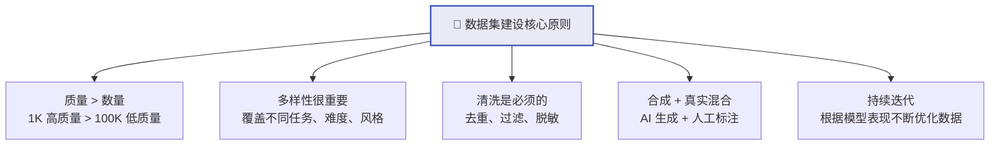

**记住这个公式：**

> **好模型 = 好数据 × 好架构 × 足够算力**
>
> 其中数据是最容易被低估、也最值得投入的环节。
